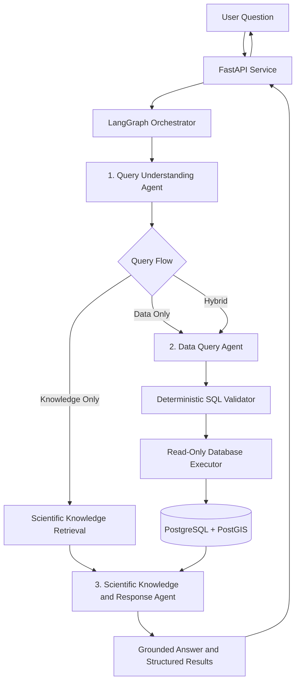

# FloatChat AI 🌊
### Agentic Conversational Platform for Oceanographic Data Discovery and Analysis

FloatChat AI is an AI-powered platform that enables users to explore and analyze **ARGO oceanographic data using natural language**. It combines agent-based reasoning, scientific document retrieval, validated SQL generation, and interactive visualization specifications to make oceanographic data more accessible.

Instead of manually writing database queries or searching technical documentation, users can ask scientific questions conversationally and receive data-backed results or explanations grounded in oceanographic knowledge.

---

## 📌 Problem Statement

Oceanographic datasets collected by ARGO floats contain valuable information about ocean temperature, salinity, pressure, and spatial-temporal patterns. However, exploring these datasets often requires specialized knowledge of database queries, data formats, and oceanographic terminology.

FloatChat AI aims to simplify this process through a conversational interface that connects natural-language questions with structured ocean data and scientific documentation while maintaining strict database safety controls.

## ✨ Key Features

- **Natural-language data discovery:** Translate user questions into structured scientific queries.
- **Agentic orchestration:** Coordinate three specialized AI agents through LangGraph.
- **Scientific RAG:** Retrieve relevant information from curated oceanographic documentation using vector similarity search.
- **Natural-language-to-SQL:** Generate schema-aware SQL for ARGO observations.
- **SQL security validation:** Enforce read-only queries, allowed tables and columns, query limits, and statement timeouts.
- **Hybrid reasoning:** Combine database results with retrieved scientific knowledge when a question needs both.
- **FastAPI service:** Expose AI functionality through HTTP endpoints.
- **Structured responses:** Return explanations, citations, data summaries, and visualization specifications.
- **Local embedding support:** Use Ollama embeddings to support document ingestion and semantic retrieval.

## 🧠 System Architecture

FloatChat AI uses exactly **three primary AI agents**, coordinated by a LangGraph workflow.



### The Three Primary Agents

**1. Query Understanding Agent**

Interprets natural-language questions and extracts structured intent, including relevant parameters, spatial bounds, time ranges, and pressure or depth constraints. It identifies whether the request requires scientific knowledge, database analysis, or both.

**2. Data Query Agent**

Transforms structured query intent into schema-aligned SQL targeting the ARGO observation tables. Generated queries pass through a deterministic security validator before execution.

**3. Scientific Knowledge and Response Agent**

Uses retrieved scientific documentation and available database results to formulate responses, provide source citations, summarize data, and generate declarative visualization specifications.

### LangGraph Orchestration

The orchestrator manages three query flows:

| Flow | Purpose |
|---|---|
| `KNOWLEDGE_ONLY` | Answers scientific questions using retrieved documentation without unnecessary database queries. |
| `DATA_ONLY` | Retrieves and analyzes structured ARGO observations. |
| `HYBRID` | Combines scientific knowledge with database results. |

The orchestration layer also coordinates execution and error handling while preserving the responsibilities of the three agents.

## 🛡️ Database Safety

Security is enforced through deterministic validation and controlled database execution rather than relying exclusively on the language model.

- Only permitted read-only SQL queries are accepted.
- Multiple SQL statements and prohibited operations are rejected.
- Tables, columns, and functions are restricted by allowlists.
- Query execution uses read-only transaction protections.
- Statement timeouts and result-row limits reduce the risk of expensive queries.
- Invalid queries are rejected before reaching the database.

The database layer uses PostgreSQL with PostGIS for spatial operations and pgvector for scientific-document embeddings.

## 🧰 Technology Stack

| Component | Technologies |
|---|---|
| Programming language | Python |
| AI orchestration | LangGraph |
| AI contracts and validation | Pydantic |
| SQL parsing and validation | sqlglot |
| API framework | FastAPI |
| Database | PostgreSQL |
| Spatial queries | PostGIS |
| Vector retrieval | pgvector |
| Embedding model | Ollama `nomic-embed-text` |
| Language model | Configured model provider; verify the selected model in the project configuration |
| Scientific data | ARGO NetCDF and normalized tabular data |
| Testing | pytest |

## 🗂️ Project Structure

The following is a conceptual overview; the exact file structure may evolve.

```text
FloatChat-AI/
├── src/
│   ├── agents/
│   │   ├── query_understanding/
│   │   ├── data_query/
│   │   └── response/
│   ├── api/
│   ├── config.py
│   ├── database/
│   ├── orchestration/
│   ├── rag/
│   └── security/
├── data/
│   └── scientific_docs/
├── scripts/
├── tests/
├── docker-compose.yml
├── pyproject.toml
├── .env.example
├── .gitignore
└── README.md
```

## ⚙️ Prerequisites

Install the following tools before running the project:

- Python 3.10 or a compatible version supported by the project
- Git
- Docker Desktop
- Ollama
- A PostgreSQL/PostGIS/pgvector database configured for FloatChat

Check installed tools:

```bash
python --version
git --version
docker --version
ollama --version
```

## 🚀 Getting Started

### 1. Clone the repository

```bash
git clone https://github.com/Prem13042005/FloatChat-AI.git
cd FloatChat-AI
```

### 2. Create a Python virtual environment

Windows — PowerShell:

```powershell
python -m venv .venv
.venv\Scripts\Activate.ps1
```

Windows — Git Bash:

```bash
python -m venv .venv
source .venv/Scripts/activate
```

### 3. Install project dependencies

Install dependencies using the project's declared configuration:

```bash
python -m pip install --upgrade pip
pip install -e ".[dev]"
```

If the project does not define a `dev` optional dependency group, use the installation command documented in `pyproject.toml` instead.

### 4. Configure environment variables

Create a local `.env` file using the example configuration:

```bash
cp .env.example .env
```

On Windows, you can also copy `.env.example` to `.env` using File Explorer.

Configure the database and model settings using the variable names supported by the application. Never commit the `.env` file or actual credentials.

### 5. Start the FloatChat database

Build and start the configured Docker database:

```bash
docker compose up -d --build
```

Check its status:

```bash
docker compose ps
```

**Important database configuration:** The FloatChat Docker database is configured to use host port `5433`, while a separate native PostgreSQL installation may use port `5432`. Confirm the actual port mapping in `docker-compose.yml` and configure the application to connect to the dedicated FloatChat database. Do not direct ingestion or database setup writes to the unrelated native database.

### 6. Configure Ollama

Start Ollama and download the embedding model:

```bash
ollama pull nomic-embed-text
```

If your configured application uses `qwen2.5:1.5b-instruct`, download it with:

```bash
ollama pull qwen2.5:1.5b-instruct
```

Only models actually required by the selected configuration need to be downloaded. Embeddings require the configured embedding model to produce the expected 768-dimensional vectors.

### 7. Start the API service

Use the actual FastAPI application import path from the repository. For example, **if** the application object is `app` in `src.api.main`, the command would be:

```bash
uvicorn src.api.main:app --reload
```

Replace the module path if your implementation uses a different entry point. Check the source code and README configuration before running this command.

## 🔌 API Endpoints

The current implementation is reported to expose the following endpoints. Request formats and response schemas should be checked against the API's Pydantic models.

| Method | Endpoint | Purpose |
|---|---|---|
| `POST` | `/api/v1/chat` | Conversational AI query processing |
| `POST` | `/api/v1/query` | Structured data-query workflow |
| `GET` | `/health` | Service health check |
| `GET` | `/ready` | Readiness check |

When the service is running locally, interactive API documentation is commonly available at `/docs` if FastAPI's documentation routes are enabled.

## 📊 ARGO Data and Scientific Knowledge

FloatChat works with ARGO oceanographic observations and scientific documentation.

The current development dataset includes measurements associated with ARGO floats and profiles, with variables such as:

- Pressure
- Temperature
- Salinity
- Latitude and longitude
- Profile timestamps

Scientific Markdown documents support retrieval-augmented generation for questions that require domain knowledge.

Dataset files and generated embeddings may be excluded from Git if they are large or reproducible. Follow the project's documented data setup procedure when those files are not included in a checkout.

## 🧪 Testing

Run the automated test suite from the project root:

```bash
pytest
```

For a concise report:

```bash
pytest -q
```

Some integration tests may require the Docker database, pgvector, Ollama, or other configured services. Review test output to distinguish passing unit tests from skipped or unavailable integration tests.

## 🔒 Security and Configuration Notes

- Never commit API keys, access tokens, passwords, or private connection strings.
- Keep `.env` local and use `.env.example` for placeholders.
- Keep database credentials out of source code and public documentation.
- Preserve SQL validation and read-only execution controls.
- Do not expose database ports publicly without appropriate access controls.
- Review any uploaded datasets for licensing and redistribution restrictions.

## 🛠️ Current Development Status

The project includes the three primary AI agents, LangGraph orchestration, scientific RAG components, deterministic SQL validation, controlled database execution, and a FastAPI service, as reported by the development audit.

Further work may include frontend integration, deployment hardening, broader scientific-data validation, and end-to-end testing across a fully configured environment.

## 🎯 Project Goal

The goal of FloatChat AI is to bridge the gap between complex oceanographic datasets and accessible scientific exploration through conversational AI, evidence-grounded responses, and secure data access.

---

## 👨‍💻 Contributors

**Prem Rajput** — AI architecture, agent development, scientific RAG, SQL validation, and orchestration.

Contributions from collaborators are welcome through issues and pull requests.

## 📄 License

A license has not yet been specified. Add an appropriate license file before presenting the project as open source.

---

*FloatChat AI — Making oceanographic data easier to discover, understand, and analyze.*