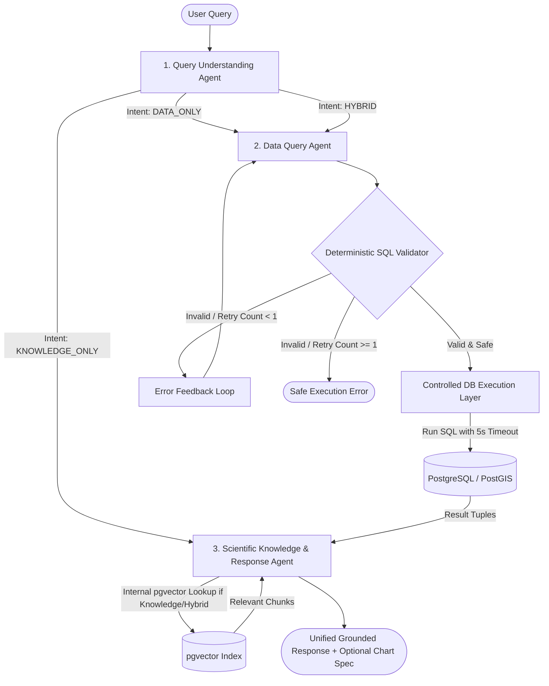

# FloatChat: AI Architecture & Orchestration Specification

**Document Version:** 1.0.0  
**Phase:** Phase 0 (Architecture & Specification)  
**Status:** Approved Specification  

---

### 1. Core AI Principles & Agent Count Enforcement

FloatChat enforces a strict architectural boundary between probabilistic LLM reasoning and deterministic software logic.

### Canonical AI Agent Count
FloatChat V1 contains **EXACTLY THREE PRIMARY AI AGENTS**:
1. **Query Understanding Agent**
2. **Data Query Agent (Text-to-SQL)**
3. **Scientific Knowledge & Response Agent**

No additional primary AI agents or autonomous sub-agents exist in V1. The former separate Scientific RAG and Result Analysis capabilities are unified within the single **Scientific Knowledge & Response Agent**.

All other system modules (LangGraph workflow orchestration, deterministic SQL validation, controlled database execution, data ingestion, vector indexing, API services, frontend UI) are **supporting software components**, NOT agents.

---

## 2. Agent Responsibilities & Taxonomy

| Agent Name | LLM Responsibility | Primary Input | Primary Output |
| :--- | :--- | :--- | :--- |
| **Query Understanding Agent** | Intent classification & spatial-temporal entity extraction into structured schema. | Raw User Natural Language Query | Strongly-typed `QueryIntent` Pydantic object |
| **Data Query Agent (Text-to-SQL)** | Translates structured intent into candidate PostGIS SQL statements targeting physical schema. | `QueryIntent` + PostGIS Table DDL | Candidate SQL Query String |
| **Scientific Knowledge & Response Agent** | Consolidates internal RAG retrieval, grounded domain answers with citations, numerical result interpretation, and visualization specifications. | User Query + Retrieved Doc Chunks + Optional DB Result Tuples | Grounded Markdown Narrative + Citations + Optional Chart Spec |

---

## 3. LangGraph State Model & Orchestration

FloatChat uses **LangGraph** as a supporting orchestration framework to maintain a strongly-typed, immutable state passed across graph nodes during query execution. LangGraph is an orchestration engine, not an agent.

### LangGraph State Schema (`FloatChatState`)
```python
from typing import TypedDict, List, Dict, Any, Optional

class FloatChatState(TypedDict):
    # Input
    user_query: str
    session_id: str
    
    # Query Understanding Outputs
    intent_type: str  # "KNOWLEDGE_ONLY", "DATA_ONLY", "HYBRID"
    extracted_slots: Dict[str, Any]  # spatial, temporal, pressure, wmo_ids, variables
    
    # Data Query Execution Path
    generated_sql: Optional[str]
    sql_valid: bool
    sql_error_message: Optional[str]
    sql_retry_count: int
    db_results: Optional[List[Dict[str, Any]]]
    db_execution_time_ms: Optional[float]
    
    # Scientific Knowledge & Response Agent Outputs
    retrieved_chunks: Optional[List[Dict[str, Any]]]
    scientific_narrative: Optional[str]
    citations: Optional[List[str]]
    visualization_spec: Optional[Dict[str, Any]]
    
    # Final Unified Output Payload
    final_response: str
```

---

## 4. Detailed 3-Flow Routing Architecture



### Flow 1: Knowledge-Only Workflow
* **Trigger:** Intent classified as `KNOWLEDGE_ONLY` (e.g., *"How do ARGO float salinity sensors work?"*).
* **Execution Path:** `User -> Query Understanding Agent -> Scientific Knowledge & Response Agent (Internal pgvector Retrieval & Citation Synthesis) -> Final Response`.
* **Latency Optimization:** Completely bypasses Data Query Agent, SQL Validator, and tabular database execution.

### Flow 2: Data-Only Workflow
* **Trigger:** Intent classified as `DATA_ONLY` (e.g., *"Find profiles in the Arabian Sea with temperature > 25°C"*).
* **Execution Path:** `User -> Query Understanding Agent -> Data Query Agent -> Deterministic SQL Validator -> Controlled DB Execution Layer -> PostgreSQL/PostGIS -> Scientific Knowledge & Response Agent (Grounded Synthesis & Visuals) -> Final Response`.
* **Security Gate:** Deterministic SQL Validator strictly enforces AST read-only checks prior to execution. The Controlled DB Execution Layer enforces `SET statement_timeout = 5000;`.
* **Synthesis & Visuals:** The third agent synthesizes a grounded explanation of the observation records and emits chart specifications when appropriate without inventing data.

### Flow 3: Hybrid Workflow
* **Trigger:** Intent classified as `HYBRID` (e.g., *"Show temperature profiles near Equator in March 2024 and explain calibration standards"*).
* **Execution Path:** `User -> Query Understanding Agent -> Data Query Agent -> Validator -> Controlled DB Execution Layer -> PostgreSQL/PostGIS -> Scientific Knowledge & Response Agent (Internal RAG Retrieval + Evidence Combination + Synthesis + Chart Spec) -> Final Response`.
* **Consolidated Grounding:** The third agent combines real database query results with authoritative ARGO documentation chunks, ensuring citations accompany domain claims while numerical observations are faithful to database results.

---

## 5. LLM Provider Abstraction Architecture

To ensure vendor independence and zero hardware lock-in, all agents consume LLMs strictly through an abstract provider interface.

```python
from abc import ABC, abstractmethod
from typing import Dict, Any, Optional, Type, TypeVar
from pydantic import BaseModel

T = TypeVar("T", bound=BaseModel)

class BaseLLMProvider(ABC):
    @abstractmethod
    def generate(self, prompt: str, system_prompt: Optional[str] = None, **kwargs) -> Any:
        pass

    @abstractmethod
    def generate_structured(self, prompt: str, response_model: Type[T], system_prompt: Optional[str] = None, **kwargs) -> T:
        pass
```

- **Primary Provider (Local):** `OllamaProvider` connecting to a local Ollama instance (`qwen2.5:1.5b-instruct` default).
- **Secondary Provider (Cloud):** `GeminiProvider` utilizing the Google GenAI SDK (lazy-loaded).
- **Rule:** Agent implementations depend strictly on `BaseLLMProvider`. Model names and configuration are injected via environment settings (`src/config.py`).

---

## 6. Grounding, Hallucination Mitigation & Failure Handling

### Grounding & Provenance
- Numerical data outputs originate **strictly** from executed PostGIS queries. LLMs are prohibited from guessing or fabricating numerical measurements.
- Scientific explanations originate **strictly** from retrieved `pgvector` document chunks with inline citations (e.g., `[ARGO User Manual v3.4, Section 3.2]`).

### Failure Handling & Retry Strategy
1. **SQL Syntax / Schema Errors:** If the Deterministic SQL Validator rejects a generated SQL query, the error string is fed back to the Data Query Agent for **exactly 1 retry attempt**.
2. **Low Vector Retrieval Confidence:** If the vector similarity score is below the threshold, the Scientific Knowledge & Response Agent explicitly states: *"Information not found in authoritative ARGO documentation"* rather than fabricating an answer.
3. **Database Execution Timeouts:** PostGIS queries are bounded by a strict 5000ms statement timeout enforced by the controlled database execution layer..
