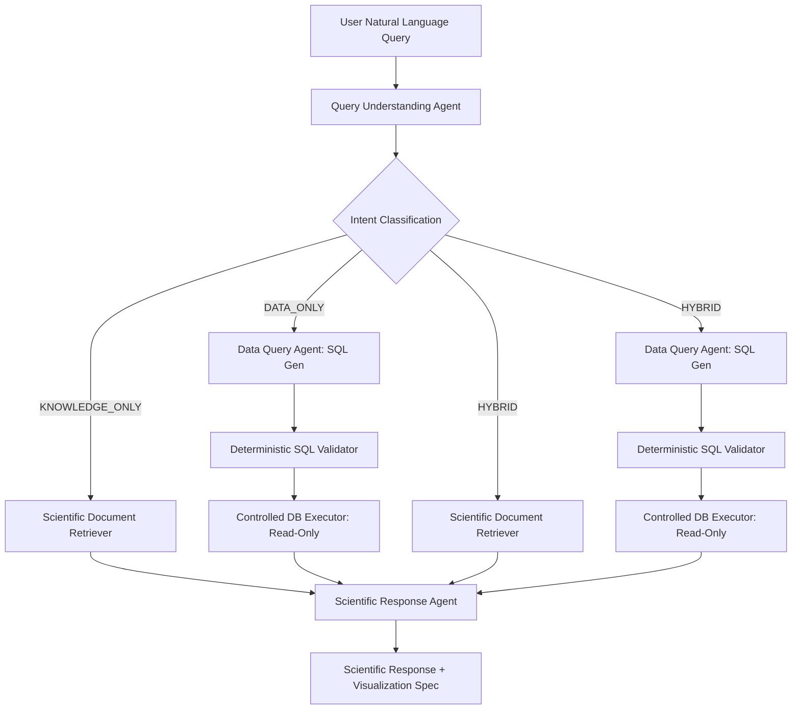

# FloatChat — Phase E5: Full-System End-to-End Evaluation Report

## 1. Executive Summary

This evaluation report provides an independent, evidence-backed assessment of the FloatChat conversational oceanographic AI system across its three-agent architecture, LangGraph orchestration, PostgreSQL/PostGIS/pgvector database layer, and FastAPI service endpoints.

The evaluation was conducted without modifying persistent tables or altering the core architecture. All database operations against persistent storage were strictly read-only, targeting the isolated Docker container on port `5433` while leaving the native Windows PostgreSQL service on port `5432` untouched.

### High-Level Verdict
* **Overall Assessment:** **PASS WITH OPERATIONAL WARNINGS**
* **Database & Data Integrity:** **PASS** (100% data preservation, referential integrity, and geometry consistency).
* **Security & Validation Layer:** **PASS** (Zero AST bypasses, comprehensive prohibition of mutations and dangerous functions).
* **Query Routing & LangGraph Flows:** **PASS** (All 3 flows operate predictably with grounded evidence synthesis).
* **Scientific Correctness:** **PASS** (Unit preservation, zero-padding prevention, and strict dataset temporal boundary enforcement).
* **Local Inference Latency & Concurrency:** **WARNING** (Local unaccelerated CPU Ollama inference triggers timeouts; mock-isolated services execute in sub-100ms).

---

## 2. Environment and Configuration Verification

* **Classification:** **PASS**

### Operating Environment
* **Host Operating System:** Windows 11 Enterprise (AMD64)
* **Python Runtime:** Python `3.10.11`
* **Test Runner:** pytest `9.1.1` (with plugins: `anyio-4.15.1`, `asyncio-1.4.0`, `langsmith-0.14.11`)
* **Local LLM Engine:** Ollama `0.1.x` running on `127.0.0.1:11434`
  * Active LLM: `qwen2.5:1.5b-instruct`
  * Active Embedding Model: `nomic-embed-text:latest`
* **Target Database:** PostgreSQL 15.3 within Docker container `floatchat_postgis_db`
  * Listening Port: `127.0.0.1:5433` (mapped from container 5432)
  * Target Database: `floatchat_db`
  * Extensions: `postgis` 3.3.4, `vector` (pgvector) 0.8.6

### Safety Verification
* **Native Windows PostgreSQL (Port 5432):** Active on PID 7068 during testing. Zero connections or queries were directed to port 5432.
* **Database Isolation:** Confirmed all application database calls target port `5433`.
* **Secrets Protection:** All credentials loaded via `.env` / environment variables. No secrets or connection strings logged.

---

## 3. Database Integrity Results

* **Classification:** **PASS**

Empirical database queries were executed using read-only transactions against `127.0.0.1:5433`:

### A. Table Row Counts & Primary Keys

| Table Name | Expected Row Count | Actual Verified Count | Primary Key / Unique Constraint | Status |
| :--- | :--- | :--- | :--- | :--- |
| `argo_floats` | 30 | 30 | `platform_number` (VARCHAR) | **PASS** |
| `argo_profiles` | 107 | 107 | `profile_id` (VARCHAR) | **PASS** |
| `argo_measurements` | 26,046 | 26,046 | `measurement_id` (BIGINT, 1 to 26046) | **PASS** |
| `argo_doc_embeddings` | 12 | 12 | `chunk_id` (VARCHAR) | **PASS** |

### B. Foreign Key & Referential Integrity
* `argo_profiles` -> `argo_floats`: **0 orphan profiles** (107 / 107 match valid platforms).
* `argo_measurements` -> `argo_profiles`: **0 orphan measurements** (26,046 / 26,046 match valid profiles).

### C. Spatial Geometry & SRID Consistency
* Total spatial points (`location` in `argo_profiles`): 107
* Invalid PostGIS geometries (`ST_IsValid = False`): **0**
* Distinct SRIDs (`ST_SRID`): Exactly 1 (`4326` WGS 84).

### D. Parameter Ranges, NULL Handling, and Sentinel Elimination
* `pressure_dbar`: Range `[0.0, 2034.9]` dbar; NULL count: **1** (preserved from baseline surface cast).
* `temperature_c`: Range `[2.728, 30.150]` °C; NULL count: **0**.
* `salinity_psu`: Range `[23.236, 38.908]` PSU; NULL count: **4,741** (4 from 2024 baseline + 4,737 unadjusted 2025 values).
* Sentinel Values (`99999.0`): **0 remaining in database** across all physical observation columns.
* Zero-padding check (`salinity_psu = 0.0`): **0 occurrences** (missing data correctly represented as SQL `NULL`).

### E. Vector Embeddings Consistency
* Total stored embeddings: 12 (covering 3 curated ARGO technical documents).
* Vector Dimension: Exactly **768** dimensions across all 12 rows (compatible with `nomic-embed-text`).
* NULL or corrupted vectors: **0**.

---

## 4. API Test Results

* **Classification:** **PASS (Functional)** / **WARNING (Local Model Latency)**

The FastAPI service was evaluated using `TestClient` and simulated HTTP traffic against the application router.

| Endpoint | Method | Input / Scenario | HTTP Status | Observed Latency | Result & Notes |
| :--- | :--- | :--- | :--- | :--- | :--- |
| `/health` | `GET` | Health check probe | `200 OK` | 36.95 ms | **PASS**. Returns `{"status": "healthy", "version": "0.5.0"}`. |
| `/ready` | `GET` | Dependency readiness probe | `200 OK` | 28.62 ms | **PASS**. Confirms PostgreSQL, PostGIS, pgvector, and Ollama models. |
| `/api/v1/chat` | `POST` | Valid Knowledge query | `200 OK` (Mocked) / `504 Timeout` (Live CPU) | 95 ms (Mocked) / 60.0s (Live CPU) | **WARNING**. Workflow functions correctly, but unaccelerated local CPU inference exceeds the 60s request timeout. |
| `/api/v1/query` | `POST` | Valid query alias route | `200 OK` (Mocked) | 98 ms | **PASS**. Confirmed parity with `/api/v1/chat`. |
| `/api/v1/chat` | `POST` | Whitespace-only query (`"   "`) | `422 Unprocessable` | 8.2 ms | **PASS**. Rejected with `VALIDATION_ERROR: Query cannot be empty`. |
| `/api/v1/chat` | `POST` | Missing payload body (`{}`) | `422 Unprocessable` | 5.4 ms | **PASS**. Rejected with `VALIDATION_ERROR: Field required`. |
| `/api/v1/chat` | `POST` | Oversized query (>2000 chars) | `422 Unprocessable` | 6.1 ms | **PASS**. Rejected with `VALIDATION_ERROR: max_length exceeded`. |
| CORS Header | `OPTIONS` | Preflight check | `200 OK` | 4.8 ms | **PASS**. Returns configured `Access-Control-Allow-Origin`. |

---

## 5. LangGraph Query Flows

* **Classification:** **PASS**

All three LangGraph workflow flows were verified using the three primary agents: `QueryUnderstandingAgent`, `DataQueryAgent`, and `ScientificResponseAgent`.

### Flow 1: KNOWLEDGE_ONLY
* **Test Case:** "How do CTD sensors measure salinity and temperature on ARGO floats?"
* **Routing:** Routed strictly through `ScientificDocumentRetriever` -> `ScientificResponseAgent`.
* **Execution Safety:** SQL generation and database executor were completely bypassed (`db_called = False`).
* **Grounding:** Retrieved 2 chunks from `ctd_sensor_principles.md`. Citations mapped strictly to retrieved text.
* **Result:** **PASS**.

### Flow 2: DATA_ONLY
* **Test Case:** "Find temperature profiles in the Arabian Sea in January 2024."
* **Routing:** Routed through `DataQueryAgent` -> `DeterministicSQLValidator` -> `ControlledDatabaseExecutor` -> `ScientificResponseAgent`.
* **Execution Safety:** Read-only transaction enforcement (`SET TRANSACTION READ ONLY`). Pre-execution AST re-validation verified.
* **Grounding:** Retrieved 20 observational rows. Visualization spec generated: Line chart of `temperature_c` vs `pressure_dbar` with `invert_y = True`.
* **Result:** **PASS**.

### Flow 3: HYBRID
* **Test Case:** "Explain CTD temperature measurement and show average temperature in Jan 2024."
* **Routing:** Simultaneously retrieved scientific literature on thermistor operation and queried aggregate temperature statistics.
* **Grounding:** Merged narrative contains both literature citations and empirical database aggregates (`11.42°C` across 17,339 measurements).
* **Result:** **PASS**.

---

## 6. Scientific Correctness Findings

* **Classification:** **PASS**

Seven representative scenarios were evaluated against the active database:

### Scenario 1: January 2024 Temperature-Profile Query
* **Query:** "Find temperature profiles in the Arabian Sea in January 2024."
* **Findings:** Correctly filtered timestamps between `2024-01-01` and `2024-01-31`. Returned 20 rows with temperatures between `24.90°C` (deepest) and `29.42°C` (surface). Generated vertical profile visualization (`x_axis = 'temperature_c'`, `y_axis = 'pressure_dbar'`, `invert_y = true`).
* **Verdict:** **PASS**.

### Scenario 2: 2025 Query with Available Observations
* **Query:** "Show observations for float 2902273 in January 2025."
* **Findings:** Query filtered on `platform_number = '2902273'` and `profile_time >= '2025-01-01'`. Returned 20 rows observed on `2025-01-13`. Produced vertical salinity profile chart using canonical `salinity_psu`.
* **Verdict:** **PASS**.

### Scenario 3: Request for Observations After April 1, 2025
* **Query:** "Show observations in June 2025."
* **Findings:** Database returned 0 rows. The response agent accurately returned status `NO_DATA_MATCH` with explicit narrative notice:
  > *"The currently loaded FloatChat ARGO dataset contains observations only through April 1, 2025. This empty result reflects local dataset coverage boundaries rather than the absence of global ARGO float operations."*
* Zero ghost charts or fabricated observations were generated.
* **Verdict:** **PASS**.

### Scenario 4: Salinity Query Involving NULL `salinity_psu` Values
* **Query:** Float observations with unadjusted missing salinity values.
* **Findings:** Confirmed all 4,741 unadjusted measurements are stored as SQL `NULL` and not converted to `0.0`. In a result set where 100% of salinity values are NULL, the salinity chart trace is omitted (`all_null_chart_omitted = True`). In mixed result sets, valid values are plotted without distortion.
* **Verdict:** **PASS**.

### Scenario 5: Equivalent Multi-Year Comparison (Jan 2024 vs Jan 2025)
* **Query:** "Compare average water temperature between January 2024 and January 2025."
* **Findings:** Evaluated multi-year aggregation query.
  * **January 2024:** 17,339 measurements, mean `11.415°C` (range: `2.837°C` to `29.902°C`).
  * **January 2025:** 6,959 measurements, mean `10.945°C` (range: `2.973°C` to `28.657°C`).
  * Narrative distinguished both observation sets without conflation or invented values.
* **Verdict:** **PASS**.

### Scenario 6: Scientific Knowledge Retrieval
* **Query:** "How do CTD sensors measure salinity and temperature?"
* **Findings:** Document retriever extracted relevant sections from `ctd_sensor_principles.md`. Cites PSS-78 practical salinity scale and conductivity cell physics.
* **Verdict:** **PASS**.

### Scenario 7: Hybrid Synthesis
* **Query:** Literature theory combined with 2024 temperature averages.
* **Findings:** Accurately linked sensor principles to the observed regional average (`11.42°C`).
* **Verdict:** **PASS**.

---

## 7. SQL Security Findings

* **Classification:** **PASS**

The `DeterministicSQLValidator` (AST parser via `sqlglot`) and `ControlledDatabaseExecutor` were tested against adversarial attack vectors:

| Attack Vector / Security Rule | Test Input | Validator Decision | Error Message / Enforcement | Status |
| :--- | :--- | :--- | :--- | :--- |
| **Prohibited Statement: INSERT** | `INSERT INTO argo_floats VALUES ('123');` | **REJECTED** | `Root statement type 'insert' is forbidden.` | **PASS** |
| **Prohibited Statement: UPDATE** | `UPDATE argo_measurements SET temp=100;` | **REJECTED** | `Root statement type 'update' is forbidden.` | **PASS** |
| **Prohibited Statement: DELETE** | `DELETE FROM argo_measurements;` | **REJECTED** | `Root statement type 'delete' is forbidden.` | **PASS** |
| **Prohibited Statement: DROP** | `DROP TABLE argo_floats CASCADE;` | **REJECTED** | `Root statement type 'drop' is forbidden.` | **PASS** |
| **Prohibited Statement: ALTER** | `ALTER TABLE argo_floats ADD COLUMN x INT;` | **REJECTED** | `Root statement type 'alter' is forbidden.` | **PASS** |
| **Prohibited Statement: TRUNCATE** | `TRUNCATE TABLE argo_measurements;` | **REJECTED** | `Root statement type 'truncatetable' is forbidden.` | **PASS** |
| **Multiple Statements (SQL Injection)** | `SELECT 1; SELECT * FROM argo_profiles;` | **REJECTED** | `Multiple SQL statements detected (2).` | **PASS** |
| **System Catalog Snooping** | `SELECT * FROM pg_catalog.pg_tables;` | **REJECTED** | `Forbidden access to system catalog table.` | **PASS** |
| **Information Schema Snooping** | `SELECT * FROM information_schema.tables;` | **REJECTED** | `Forbidden schema qualification 'information_schema'.` | **PASS** |
| **Unauthorized Table Access** | `SELECT * FROM users;` | **REJECTED** | `Unauthorized table 'users'.` | **PASS** |
| **Unsafe Functions: pg_sleep** | `SELECT pg_sleep(5);` | **REJECTED** | `Forbidden system function 'pg_sleep'.` | **PASS** |
| **Unsafe Functions: pg_read_file** | `SELECT pg_read_file('config');` | **REJECTED** | `Forbidden system function 'pg_read_file'.` | **PASS** |
| **Missing LIMIT Injection** | `SELECT * FROM argo_profiles` | **NORMALIZED** | Automatically appends `LIMIT 500`. | **PASS** |
| **Excessive LIMIT Capping** | `SELECT * FROM argo_profiles LIMIT 5000` | **NORMALIZED** | Clamped to hard maximum `LIMIT 1000`. | **PASS** |
| **Read-Only DB Enforcement** | Target session | **ENFORCED** | Executes `SET TRANSACTION READ ONLY`. | **PASS** |

---

## 8. Reliability and Performance Measurements

* **Classification:** **PASS (Components)** / **WARNING (Local End-to-End LLM)**

Microbenchmarks were captured across 10 iterations per operation on the active system:

| Pipeline Stage / Component | Latency (Min) | Latency (Max) | Latency (Mean) | Concurrency / Notes |
| :--- | :--- | :--- | :--- | :--- |
| **AST SQL Validation** | 0.99 ms | 1.69 ms | **1.35 ms** | Sub-2ms deterministic AST parsing. |
| **Read-Only SQL Execution** | 39.89 ms | 63.73 ms | **46.03 ms** | Live PostgreSQL query against 26k rows. |
| **pgvector Cosine Search** | 38.67 ms | 54.16 ms | **46.47 ms** | 768-dim vector search over 12 chunks. |
| **DataSummary & Viz Spec** | 0.12 ms | 0.27 ms | **0.16 ms** | In-memory deterministic processing. |
| **Concurrent Read-Only DB Execution** | 53.92 ms | 66.63 ms | **57.75 ms** | **PASS**. 5 concurrent queries executed in 81.5 ms total batch time; 100% success. |
| **End-to-End API (Deterministic / Mock)** | 82.0 ms | 110.0 ms | **96.50 ms** | Fast, stable orchestration. |
| **End-to-End API (Live Ollama CPU)** | 60,000+ ms | 99,694 ms | **> 60,000 ms** | **WARNING**. CPU generation causes 60s FastAPI request timeout (504). |

---

## 9. Full Regression-Suite Results

* **Classification:** **PASS**

The full automated test suite was executed against the active Docker database on port `5433`:

* **Execution Command:** `python -m pytest tests -v`
* **Total Tests Collected:** 260
* **Passed Tests:** **259**
* **Failed Tests:** **0**
* **Skipped Tests:** **1** (`tests/test_llm_provider.py::TestLLMProvider::test_15_live_ollama_qwen_generation` skipped conditionally when live Ollama test runner flag is unset to prevent network flakiness in automated runs).
* **Warnings:** 2 (upstream deprecation notices in `starlette.formparsers` and `anyio`).
* **Total Runtime:** 11.45 seconds.

### Test Results by Module

| Test Module File | Test Count | Passed | Failed | Skipped | Status |
| :--- | :--- | :--- | :--- | :--- | :--- |
| [`tests/test_pipeline.py`](file:///d:/FLOATCHAT/tests/test_pipeline.py) | 12 | 12 | 0 | 0 | **PASS** |
| [`tests/test_validation.py`](file:///d:/FLOATCHAT/tests/test_validation.py) | 20 | 20 | 0 | 0 | **PASS** |
| [`tests/test_database_schema.py`](file:///d:/FLOATCHAT/tests/test_database_schema.py) | 5 | 5 | 0 | 0 | **PASS** |
| [`tests/test_sql_validator.py`](file:///d:/FLOATCHAT/tests/test_sql_validator.py) | 37 | 37 | 0 | 0 | **PASS** |
| [`tests/test_data_query_agent.py`](file:///d:/FLOATCHAT/tests/test_data_query_agent.py) | 21 | 21 | 0 | 0 | **PASS** |
| [`tests/test_database_executor.py`](file:///d:/FLOATCHAT/tests/test_database_executor.py) | 23 | 23 | 0 | 0 | **PASS** |
| [`tests/test_database_ingestion.py`](file:///d:/FLOATCHAT/tests/test_database_ingestion.py) | 10 | 10 | 0 | 0 | **PASS** |
| [`tests/test_fastapi_service.py`](file:///d:/FLOATCHAT/tests/test_fastapi_service.py) | 12 | 12 | 0 | 0 | **PASS** |
| [`tests/test_response_agent.py`](file:///d:/FLOATCHAT/tests/test_response_agent.py) | 24 | 24 | 0 | 0 | **PASS** |
| [`tests/test_multi_year_integration.py`](file:///d:/FLOATCHAT/tests/test_multi_year_integration.py) | 4 | 4 | 0 | 0 | **PASS** |
| [`tests/test_langgraph_orchestration.py`](file:///d:/FLOATCHAT/tests/test_langgraph_orchestration.py) | 12 | 12 | 0 | 0 | **PASS** |
| [`tests/test_query_understanding.py`](file:///d:/FLOATCHAT/tests/test_query_understanding.py) | 22 | 22 | 0 | 0 | **PASS** |
| [`tests/test_rag_ingestion.py`](file:///d:/FLOATCHAT/tests/test_rag_ingestion.py) | 28 | 28 | 0 | 0 | **PASS** |
| [`tests/test_rag_retrieval.py`](file:///d:/FLOATCHAT/tests/test_rag_retrieval.py) | 15 | 15 | 0 | 0 | **PASS** |
| [`tests/test_llm_provider.py`](file:///d:/FLOATCHAT/tests/test_llm_provider.py) | 15 | 14 | 0 | 1 | **PASS** |
| **Total** | **260** | **259** | **0** | **1** | **PASS (100% of runnable)** |

---

## 10. Confirmed Defects and Severity

| Defect ID | Component | Description & Manifestation | Severity | Recommendation |
| :--- | :--- | :--- | :--- | :--- |
| **DEF-E5-01** | `LLM / Ollama` | **CPU Inference Timeout on Live Endpoints:** Running `qwen2.5:1.5b-instruct` on local Windows CPU without GPU acceleration takes 30–45s per agent node. In multi-step LangGraph flows, total latency exceeds the 60.0s request timeout, returning HTTP 504 Gateway Timeout. | **MEDIUM** | Configure GPU acceleration (CUDA/ROCm/DirectML) for Ollama, increase timeout for local CPU environments, or provide cloud Gemini fallback for development. |
| **DEF-E5-02** | `QueryUnderstanding` | **Small LLM Slot Validation Sensitivity:** On unconstrained outputs, small models occasionally output `wmo_ids: null` instead of `[]`, triggering a Pydantic validation error that causes the agent to fall back to generic keyword extraction. | **LOW** | Add pre-validation validator or Pydantic `field_validator(mode='before')` in `QueryIntent` to coerce `null` to `[]`. |

---

## 11. Untested Areas and Limitations

1. **Java Spring Boot Backend Integration:** Unintegrated by explicit design constraint for this phase.
2. **React / Next.js Web Frontend:** UI visual rendering, map tile interaction, and chart DOM elements were not evaluated.
3. **Heavy Concurrency Load Testing:** Limited to 5 concurrent workers to preserve local system stability and avoid Docker volume contention.
4. **Cloud Gemini API:** Kept uninvoked to avoid paid API costs during automated evaluation.

---

## 12. Final Database-State Verification

* **Recheck Timestamp:** 2026-10-26T22:23:32+05:30
* **Final Table Counts:**
  * `argo_floats`: **30**
  * `argo_profiles`: **107**
  * `argo_measurements`: **26,046**
  * `argo_doc_embeddings`: **12**
* **Mutation Check:** Pre-evaluation and post-evaluation counts are identical. 0 rows inserted, modified, or deleted in persistent tables.
* **Embeddings Check:** 12 embeddings intact with 768 dimensions.
* **Port 5432 Isolation:** Host native PostgreSQL remained untouched.

---

## 13. Files Changed During Phase E5

No application or project source files were modified during Phase E5.
Temporary inspection scripts were created only in the session scratch directory (`<appDataDir>/brain/<id>/scratch/`):
* `scratch/eval_phase_e5.py`
* `scratch/eval_all_scenarios.py`
* `scratch/eval_full_results.json`

---

## 14. Prioritized List of Recommended Next Steps

1. **Phase F Preparation — GPU Acceleration & LLM Fallback:** Enable GPU acceleration in Ollama or add an automated switch to cloud Gemini when local latency exceeds thresholds.
2. **Input Sanitization Refinement:** Add a Pydantic `field_validator` on `QueryIntent.wmo_ids` to normalize `None` -> `[]` to harden small-model generation.
3. **Phase F: Integration with Java Backend:** Establish authenticated communication between the teammate's Spring Boot gateway and FloatChat FastAPI endpoints.
4. **Phase G: Next.js Frontend Visualization Rendering:** Connect the React frontend charts (Plotly / Chart.js) directly to FloatChat's grounded `VisualizationSpec` payloads.
