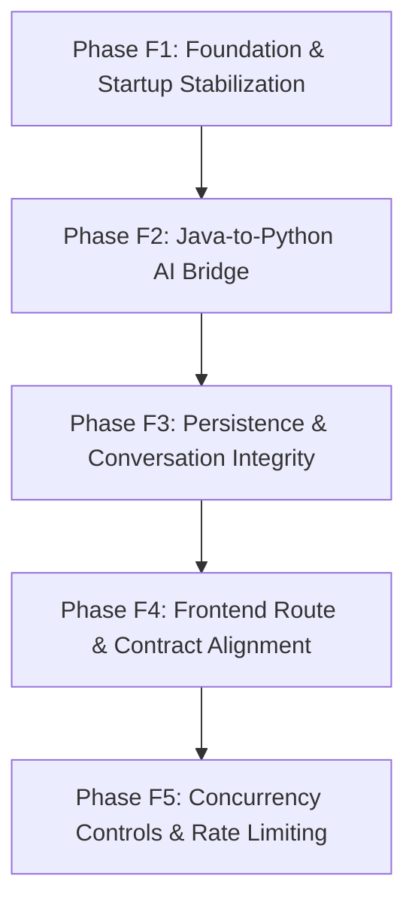

# FloatChat Pre-Integration Audit Report: Phase F0 Integration Readiness

**Document Version:** 1.0.0  
**Audit Date:** 2026-10-27  
**Auditor:** Senior Software Engineer (AI Systems & Full-Stack Integration)  
**Status:** Audit Complete — Integration Blocked Pending Phase F1 Resolution  

---

## Executive Summary

FloatChat combines an advanced Python scientific AI service (FastAPI, LangGraph multi-agent orchestration, PostgreSQL/PostGIS/pgvector RAG) with a recently imported Java Spring Boot backend (`backend/`) and React/Vite single-page application (`frontend/`).

This audit evaluated codebases across all three tiers to determine operational and architectural readiness for end-to-end integration. 

**Key Audit Verdicts:**
1. **Critical Application Startup Blocker:** Java backend will fail to start due to an `AmbiguousMappingException` caused by duplicate controller mappings (`POST /api/v1/auth/admins` declared simultaneously in both `AuthController` and `AdminManagementController`).
2. **Disconnected AI Layer:** The Java chat flow operates **exclusively in mock demonstration mode**. The real Python AI client (`AiServiceClient`) is dead code—it is never autowired, injected, or executed. Furthermore, `AiServiceClient` targets non-existent endpoint `/api/query`, uses mismatched field names (`question` vs. `query`), and expects response fields (`confidence`, `points`) that Python does not provide.
3. **Database Architecture Disconnect:** Docker Compose deploys PostgreSQL 15 + PostGIS + pgvector on isolated host port `5433` (leaving native PostgreSQL on `5432` untouched). However, the Java backend `application.properties` and SQL migration scripts are hard-configured for a **MySQL** instance on `localhost:3306`, for which no Docker container or configuration is present.
4. **Extensive Frontend-to-Backend Route Inconsistencies:** The React frontend contains severe route prefix discrepancies (services omitting `/api/v1`), references non-existent endpoints (e.g., `/dashboard/stats`, `/conversations/{id}`, password reset endpoints, user administration), and misinterprets pagination data structures (breaking query history display).
5. **Zero Active Rate Limiting or Inference Concurrency Protection:** Neither Java nor Python contains any rate-limiting filters, token buckets, IP throttles, or concurrency semaphores. Uncontrolled concurrent queries to CPU-based local Ollama instances will cause CPU saturation, high latencies, and service timeouts.

---

## 1. Actual Repository Structure & Environmental Inventory

### 1.1 Repository Layout Discovery

The project root is located at `d:/FLOATCHAT`. The directory contains three distinct sub-architectures alongside scientific data and documentation:

```
d:/FLOATCHAT/
├── .env                              # Root environment configuration (Python & Docker)
├── .env.example                      # Documented configuration template
├── pyproject.toml                    # Python project metadata and dependencies
├── docker-compose.yml                # Container definition for isolated scientific DB
├── README.md                         # Project documentation overview
├── docker/
│   └── Dockerfile.db                 # PostGIS + pgvector PostgreSQL 15 image builder
├── scripts/
│   ├── init-db.sql                   # Scientific DDL (argo_floats, argo_profiles, argo_measurements, argo_doc_embeddings)
│   ├── ingest_argo.py                # NetCDF ingest pipeline
│   └── index_rag.py                  # Scientific manual RAG ingestion pipeline
├── src/                              # Python AI Service (Root Package)
│   ├── agents/                       # Specialized AI agent logic
│   │   ├── query_understanding/      # Intent parsing & taxonomy router
│   │   ├── data_query/               # Text-to-SQL generation & SQLGlot validation
│   │   └── response/                 # Grounded synthesis, citation & chart spec generation
│   ├── api/                          # FastAPI REST application
│   │   ├── main.py                   # App factory, lifespan, CORS, and endpoints
│   │   └── models.py                 # Pydantic schemas (ChatRequest, ChatResponse, etc.)
│   ├── config.py                     # Centralized environment reader dataclass
│   ├── database/                     # psycopg2 connection pool & safe executor
│   ├── llm/                          # Ollama & Gemini LLM abstraction providers
│   ├── orchestration/                # LangGraph state machine & graph compilation
│   ├── rag/                          # Chunking, nomic embeddings & pgvector retrieval
│   └── security/                     # SQL AST validator & sanitization utilities
├── tests/                            # Comprehensive Python test suite (15 suites)
├── backend/                          # Java Spring Boot Application
│   ├── pom.xml                       # Maven build descriptor (Java 21, Spring Boot 3.3.5)
│   ├── mvnw, mvnw.cmd                # Maven wrapper
│   └── src/
│       ├── main/
│       │   ├── java/com/floatchat/backend/
│       │   │   ├── FloatChatApplication.java
│       │   │   ├── config/SecurityConfig.java
│       │   │   ├── controller/   # 6 REST Controllers
│       │   │   ├── dto/          # Auth and Chat DTO records
│       │   │   ├── entity/       # JPA Entities: User, Conversation, QueryHistory
│       │   │   ├── exception/    # Custom exception classes
│       │   │   ├── integration/  # AiProvider interface & MockAiProvider
│       │   │   ├── repository/   # Spring Data JPA repositories
│       │   │   ├── security/     # JwtService & JwtAuthenticationFilter
│       │   │   └── service/      # AuthService, ChatService, DashboardService, AiServiceClient
│       │   └── resources/
│       │       ├── application.properties
│       │       └── db/migration/V1__create_initial_schema.sql (MySQL Dialect)
│       └── test/java/com/floatchat/backend/
│           └── BackendApplicationTests.java (Empty contextLoads test)
├── frontend/                         # React/Vite Single Page Application
│   ├── package.json                  # Dependencies (React 18.3.1, Vite 6.0.7, Axios, Leaflet, Recharts)
│   ├── vite.config.js                # Vite configuration (no proxy configured)
│   ├── .env                          # Frontend environment (currently empty, 0 bytes)
│   └── src/
│       ├── App.jsx                   # React Router routing hierarchy
│       ├── main.jsx                  # React DOM mount point
│       ├── context/AuthContext.jsx   # Global authentication context & state
│       ├── services/                 # Axios clients: api.js, authService.js, chatService.js, etc.
│       ├── pages/                    # 18 Page components (Chat, Dashboards, Auth, Visualizations)
│       └── components/               # Navbar, ProtectedRoute, UI components
└── docs/                             # 24 Architecture, specification, and evaluation documents
```

### 1.2 Environment Variable Inventory (Keys Only)

In strict adherence to security boundaries, no secret values or credentials were printed or recorded. The following keys govern the services:

* **Python AI Service & Docker (`.env` / `src/config.py`):**
  * `LLM_PROVIDER`, `OLLAMA_BASE_URL`, `OLLAMA_MODEL`, `OLLAMA_TIMEOUT_SECONDS`
  * `GEMINI_API_KEY`, `GEMINI_MODEL`, `GEMINI_TIMEOUT_SECONDS`
  * `POSTGRES_HOST`, `POSTGRES_PORT`, `POSTGRES_DB`, `POSTGRES_USER`, `POSTGRES_PASSWORD`, `POSTGRES_STATEMENT_TIMEOUT_MS`
  * `EMBEDDING_PROVIDER`, `EMBEDDING_MODEL`, `EXPECTED_EMBEDDING_DIMENSION`, `VECTOR_TOP_K`, `VECTOR_SIMILARITY_THRESHOLD`
  * `FASTAPI_HOST`, `FASTAPI_PORT`, `FASTAPI_ENV`, `LOG_LEVEL`
  * *Confirmed runtime observation:* In `.env`, `POSTGRES_PORT` is set to `5433` (matching the isolated Docker host port mapping `5433:5432`), preserving the native host port `5432`.

* **Java Backend (`backend/src/main/resources/application.properties`):**
  * `spring.application.name`, `server.port`
  * `spring.datasource.url`, `spring.datasource.username`, `spring.datasource.password`, `spring.datasource.driver-class-name`
  * `spring.jpa.hibernate.ddl-auto`, `spring.jpa.show-sql`, `spring.jpa.properties.hibernate.format_sql`, `spring.jpa.database-platform`
  * `app.frontend-url`, `app.jwt.secret` (`JWT_SECRET`), `app.jwt.expiration-ms`
  * `ai.service.url`
  * `spring.servlet.multipart.max-file-size`, `spring.servlet.multipart.max-request-size`
  * `app.security.bootstrap-secret` (referenced in `AuthController` / `AuthService`)
  * `app.ai.mode` (referenced in `MockAiProvider` and `HealthController`)

* **Frontend (`frontend/.env` & `frontend/src/services/api.js`):**
  * `VITE_API_BASE_URL` (defaults to `http://localhost:8080`)

---

## 2. Java-to-Python Integration Findings

### 2.1 Complete Java Chat Request Flow Traced

The actual flow executed upon sending a message from a client is:
1. **Entry:** Client sends `POST /api/v1/chat` with body `{"question": "...", "conversationId": 123}` and Bearer JWT in the `Authorization` header.
2. **Security & Auth:** `JwtAuthenticationFilter` intercepts the request, calls `jwtService.extractUsername(token)`, queries `userRepository.findByEmailIgnoreCase()`, and establishes the `UsernamePasswordAuthenticationToken` in the Spring `SecurityContext`.
3. **Controller:** `ChatController.chat(Authentication, @Valid @RequestBody ChatDtos.ChatRequest)` receives the request. It extracts `authentication.getName()` (user email) and delegates to `ChatService.ask(email, request)`.
4. **Conversation Lookup / Creation:** In `ChatService.ask()`:
   * If `request.conversationId()` is null, a new `Conversation` entity is persisted with the first 190 characters of the question as the title.
   * If `request.conversationId()` is provided, it validates ownership via `conversationRepository.findByIdAndUser_Email(id, email)`. If not found or owned by another user, it throws HTTP 404.
5. **AI Invocation:** `ChatService` calls `aiProvider.answer(request.question())`.
6. **Query History Logging:** A `QueryHistory` entity is created, populated with the user, conversation, question, and answer string, and saved to `historyRepository`.
7. **Response Construction:** Returns `ChatDtos.ChatResponse` containing `conversationId`, `answer`, `demo`, `sql`, `sources`, and `createdAt`.

### 2.2 Core Findings on Java-to-Python Integration

#### Finding 2.2.1: Real Chat Flow Exclusively Uses Mock AI Provider
* **Confirmed:** In `ChatService.java`, the injected dependency is `private final AiProvider aiProvider;`.
* The only bean implementing `AiProvider` in the entire codebase is `MockAiProvider.java`.
* `MockAiProvider` is annotated with `@ConditionalOnProperty(name = "app.ai.mode", havingValue = "mock", matchIfMissing = true)`.
* In `application.properties`, `app.ai.mode` is completely absent. Therefore, Spring Boot always selects `MockAiProvider` on startup.
* When invoked, `MockAiProvider` returns a hardcoded static markdown template stating: *"This is a demonstration response, not a result generated by a real AI model or scientific dataset."*

#### Finding 2.2.2: Python Client is Completely Dead Code
* **Confirmed:** `AiServiceClient.java` exists in `backend/src/main/java/com/floatchat/backend/service/AiServiceClient.java`.
* `AiServiceClient` **does not implement** the `AiProvider` interface.
* Grep verification confirms `AiServiceClient` is not autowired, injected, or referenced anywhere in `ChatService`, `ChatController`, or any other class in the application.

#### Finding 2.2.3: Incompatible Target Endpoints
* **Confirmed:** `AiServiceClient` defines:
  ```java
  return restClient.post().uri("/api/query")...
  ```
* Base URL is loaded from `ai.service.url=http://localhost:8000`. Thus, `AiServiceClient` sends requests to `http://localhost:8000/api/query`.
* Python's FastAPI service (`src/api/main.py`) defines:
  * `POST /api/v1/chat` (Primary endpoint)
  * `POST /api/v1/query` (Documented contract alias)
* Python does **not** expose `/api/query`. Any invocation of `AiServiceClient` will result in an immediate HTTP 404 Not Found from FastAPI.

#### Finding 2.2.4: Severe DTO & Schema Mismatches
* **Request Payload Mismatch:**
  * Java `AiServiceClient` sends `QueryRequest(String question)`. When serialized to JSON, it yields `{"question": "..."}`.
  * Python FastAPI `ChatRequest` (`src/api/models.py`) strictly specifies:
    ```python
    query: str = Field(..., min_length=1, max_length=2000)
    session_id: Optional[str] = Field(default=None)
    ```
  * When Python receives `{"question": "..."}`, Pydantic validation fails immediately and returns **HTTP 422 Unprocessable Entity**:
    `{"error_code": "VALIDATION_ERROR", "message": "body -> query: Field required"}`.
* **Response Payload Mismatch:**
  * Java `AiServiceClient` expects `QueryResponse`:
    ```java
    public record QueryResponse(
        String answer,
        String sql,
        Double confidence,
        Long executionMs,
        List<Map<String, Object>> points
    ) {}
    ```
  * Python FastAPI `ChatResponse` returns:
    ```json
    {
      "session_id": "string",
      "intent_type": "string",
      "answer": "string",
      "citations": [ { "title": "...", "url": "..." } ],
      "sql_meta": { "generated_sql": "...", "execution_time_ms": 12.3, "row_count": 5, "is_truncated": false },
      "visualization_spec": { "chart_type": "line", "x_axis": "...", "y_axis": "...", "title": "..." },
      "data_summary": { ... },
      "status": "SUCCESS",
      "warnings": []
    }
    ```
  * Python does not return top-level `sql`, `confidence`, `executionMs`, or `points`.
  * Jackson deserialization into `QueryResponse` will drop or nullify scientific metadata, SQL queries, and visualization specifications.
  * Furthermore, `AiProvider.AiAnswer` in Java only models `(answer, demo, sql, sources)`. It lacks data structures to hold `visualization_spec`, `data_summary`, `intent_type`, or `warnings`.

#### Finding 2.2.5: Missing Timeouts, Resilience, and Error Handling
* **Confirmed:** In `AiServiceClient.java`, `RestClient` is constructed as:
  ```java
  this.restClient = RestClient.builder().baseUrl(aiServiceUrl).build();
  ```
* No connect timeout or read timeout is configured on the underlying HTTP client.
* Python AI execution (involving local LLM inference via Ollama or complex pgvector similarity searches) can take between 5 and 45 seconds. Under heavy load or an Ollama hang, the Java thread will block indefinitely, exhausting the Tomcat worker pool.
* There is no circuit breaker (e.g., Resilience4j), retry logic, or graceful degradation to informative error messages.

#### Finding 2.2.6: Conversation Ownership & Message Persistence
* **Ownership Check:** Preserved correctly in `ChatService.ask()` via `conversationRepository.findByIdAndUser_Email()`. A user cannot inject messages into another user's conversation ID.
* **Context Forwarding:** The Java backend does **not** forward `session_id` or conversation history to the Python AI service. Every AI query is treated as an isolated, stateless interaction.
* **Database Entity Gap:** While SQL migration `V1__create_initial_schema.sql` defines a `chat_messages` table, there is **no corresponding `ChatMessage` entity, repository, or service logic** in the Java backend. Individual messages are not saved in a messages table; only the composite question and answer are recorded in `query_history`.

---

## 3. Frontend-to-Java Integration Audit

### 3.1 Architecture of Frontend API Consumption

The React frontend utilizes Axios instances created in `frontend/src/services/api.js`. The default `baseURL` is set to `http://localhost:8080`.
The application attaches JWT tokens stored in `localStorage` under `floatchat_token`.

### 3.2 Confirmed Integration Mismatch Table

The following table details confirmed discrepancies between frontend calls and backend controller implementations:

| Feature Area | Frontend File & Line | Frontend Endpoint Called | Actual Java Endpoint | Confirmed Status / Impact |
| :--- | :--- | :--- | :--- | :--- |
| **Admin Controller Mapping Conflict** | `backend/src/main/.../AdminManagementController.java:28` & `AuthController.java:98` | N/A (Backend Internal) | `POST /api/v1/auth/admins` declared twice | **CRITICAL STARTUP FAILURE:** Spring Boot fails to start with `IllegalStateException: Ambiguous mapping`. |
| **Chat Execution** | `frontend/src/services/chatService.js:4` | `POST /chat` | `POST /api/v1/chat` | **404 / 403 Error:** Missing `/api/v1` prefix. Backend rejects with 403 Forbidden or 404 Not Found. |
| **Conversations List** | `frontend/src/services/chatService.js:13` | `GET /conversations` | `GET /api/v1/conversations` | **404 / 403 Error:** Missing `/api/v1` prefix. |
| **Single Conversation Retrieval** | `frontend/src/services/chatService.js:18` | `GET /conversations/{id}` | None (Does not exist) | **Missing Endpoint:** Java `ChatController` has no endpoint to fetch a single conversation. |
| **Conversation Message History** | `frontend/src/pages/Chat.jsx:70` | Reads `item.messages` from `getConversations()` | Returns `List<ConversationResponse(id, title, createdAt)>` | **Data Gap:** `ConversationResponse` does not include messages; clicking a conversation in sidebar displays zero messages. |
| **Delete Conversation** | `frontend/src/services/chatService.js:23` | `DELETE /conversations/{id}` | `DELETE /api/v1/conversations/{id}` | **404 / 403 Error:** Missing `/api/v1` prefix. |
| **Query History Path** | `frontend/src/services/historyService.js:4` | `GET /history?page=0&size=10` | `GET /api/v1/history` | **404 / 403 Error:** Missing `/api/v1` prefix. |
| **Query History Shape** | `frontend/src/pages/QueryHistory.jsx:19` | Expects `{ content: [...], totalPages: N }` | Returns bare JSON array: `List<HistoryResponse>` | **UI Bug:** `data.content` evaluates to `undefined`; page permanently displays "No saved queries yet". |
| **Single History Item** | `frontend/src/services/historyService.js:12` | `GET /history/{id}` | None (Does not exist) | **Missing Endpoint:** Java backend provides no single history lookup endpoint. |
| **Dashboard Stats** | `frontend/src/services/dashboardService.js:4` | `GET /dashboard/stats` | None exposed (`DashboardService.stats` is orphaned) | **404 Error:** Backend `DashboardController` does not expose `/api/v1/dashboard/stats`. |
| **Dashboard Activity** | `frontend/src/services/dashboardService.js:9` | `GET /dashboard/activity` | None (Does not exist) | **Missing Endpoint:** No activity endpoint in Java backend. |
| **Role Dashboard (USER)** | `frontend/src/pages/RoleDashboard.jsx:11` | `GET /user/dashboard` | `GET /api/v1/user/dashboard` | **404 / 403 Error:** Missing `/api/v1` prefix. |
| **Role Dashboard (ADMIN)** | `frontend/src/pages/RoleDashboard.jsx:21` | `GET /admin/dashboard` | `GET /api/v1/admin/dashboard` | **404 / 403 Error:** Missing `/api/v1` prefix. |
| **Role Dashboard (SUPER_ADMIN)** | `frontend/src/pages/RoleDashboard.jsx:31` | `GET /super-admin/dashboard` | `GET /api/v1/super-admin/dashboard` | **404 / 403 Error:** Missing `/api/v1` prefix. |
| **System Admin Health Probe** | `frontend/src/pages/SystemAdministration.jsx:14` | `GET /health` | `GET /api/v1/health` (Requires Auth) | **403 Forbidden / 404:** Missing `/api/v1` prefix, and backend requires authentication for health. |
| **System Admin AI Status** | `frontend/src/pages/SystemAdministration.jsx:15` | `GET /ai/status` | `GET /api/v1/ai/status` | **404 / 403 Error:** Missing `/api/v1` prefix. |
| **User Management: List** | `frontend/src/services/adminService.js:4` | `GET /admin/users` | None (Does not exist) | **Missing Endpoint:** No user listing endpoint exists in backend. |
| **User Management: Update Role** | `frontend/src/services/adminService.js:12` | `PATCH /admin/users/{id}/role` | None (Does not exist) | **Missing Endpoint:** Role modification endpoint absent from backend. |
| **User Management: Update Status** | `frontend/src/services/adminService.js:17` | `PATCH /admin/users/{id}/status` | None (Does not exist) | **Missing Endpoint:** Account enable/disable endpoint absent from backend. |
| **Admin Audit Logs** | `frontend/src/services/adminService.js:25` | `GET /admin/audit-logs` | None (Does not exist) | **Missing Endpoint:** Audit log retrieval endpoint absent from backend. |
| **Forgot Password** | `frontend/src/services/authService.js:77` | `POST /api/v1/auth/forgot-password` | None (Does not exist) | **Missing Endpoint:** Code comments explicitly confirm: "Backend endpoint must be implemented". |
| **Reset Password** | `frontend/src/services/authService.js:87` | `POST /api/v1/auth/reset-password` | None (Does not exist) | **Missing Endpoint:** Password reset token processing absent from backend. |
| **Change Password** | `frontend/src/services/authService.js:101` | `POST /api/v1/auth/change-password` | None (Does not exist) | **Missing Endpoint:** Authenticated password update absent from backend. |
| **Visualizations List** | `frontend/src/services/visualizationService.js:4` | `GET /visualizations` | `GET /api/v1/visualizations` | **404 / 403 Error:** Missing `/api/v1` prefix; backend hardcodes empty list `List.of()`. |
| **Single Visualization** | `frontend/src/services/visualizationService.js:9` | `GET /visualizations/{id}` | `GET /api/v1/visualizations/{id}` | **404 Not Found:** Backend explicitly throws HTTP 404 ResponseStatusException. |
| **Legacy AI Query in api.js** | `frontend/src/services/api.js:77` | `POST /api/v1/query` | None in Java (Only in Python) | **Mismatched Route:** Direct call to Java `/api/v1/query` fails with 404/403. |
| **Legacy History in api.js** | `frontend/src/services/api.js:86` | `GET /api/v1/query/history` | `GET /api/v1/history` | **Mismatched Route:** Duplicate service method targets wrong path. |

---

## 4. Rate Limiting and Concurrency Audit

### 4.1 Search for Existing Protections

A comprehensive codebase search across both Java and Python repositories yielded the following:
* **Java (`backend/`):**
  * Rate-limiting filters/interceptors: **0 found** (No Bucket4j, Resilience4j, Guava RateLimiter, or custom `OncePerRequestFilter`).
  * Per-user / Per-IP quotas: **0 found**.
  * Authentication throttling (brute-force defense): **0 found**.
  * AI concurrency controls: **0 found**.
* **Python (`src/`):**
  * Rate-limiting middleware: **0 found** (No SlowAPI, limits, or fastapi-limiter).
  * Inference concurrency controls: **0 found** (No `asyncio.Semaphore` around LangGraph or LLM execution).
  * Request quotas: **0 found**.
* **Existing Defenses Limited Strictly To:**
  1. Input size validation: Pydantic `max_length=2000` on `ChatRequest.query` and `@Size(max = 2000)` on Java `ChatDtos.ChatRequest.question`.
  2. Spring multipart upload ceiling: `20MB`.
  3. Python workflow timeout: `asyncio.wait_for(timeout=60.0)` in `src/api/main.py`.
  4. PostgreSQL statement timeout: `POSTGRES_STATEMENT_TIMEOUT_MS=5000` (5 seconds).
  5. LLM HTTP client timeouts: 30.0s for Ollama / Gemini in Python.

### 4.2 Minimal, Maintainable Rate-Limiting Design

To ensure high reliability without bloated dependencies or architectural redundancy, rate-limiting responsibilities must be cleanly divided according to service boundaries:

```
[ Frontend Client ]
        │
        ▼ (Public Internet)
┌─────────────────────────────────────────────────────────────┐
│                 Spring Boot Gateway (Port 8080)             │
│                                                             │
│  [ Filter 1: Per-IP Rate Limiter (Token Bucket / Sliding) ] │  <-- Throttles unauthenticated endpoints
│       - /api/v1/auth/login (e.g., 5 req/min)                │
│       - /api/v1/auth/signup (e.g., 3 req/min)               │
│       - /api/v1/auth/bootstrap-super-admin (e.g., 3 req/min)│
│                                                             │
│  [ Filter 2: Per-User Chat Limiter (SecurityContext Keyed) ]│  <-- Protects system against query flooding
│       - /api/v1/chat (e.g., 20 req/min per user)            │
│                                                             │
│  [ RestClient with Strict Timeout & Circuit Breaker ]       │  <-- Connect: 3s, Read: 65s
└─────────────────────────────────────────────────────────────┘
        │
        ▼ (Internal Network / Docker Network)
┌─────────────────────────────────────────────────────────────┐
│                 Python FastAPI AI Service (Port 8000)       │
│                                                             │
│  [ Concurrency Gate: asyncio.Semaphore(1 or 2) ]           │  <-- Protects CPU-based Ollama inference
│       - Rejects excess concurrent queries immediately with  │      from thrashing and memory exhaustion
│         HTTP 429 / 503 + "Retry-After: 5"                   │
└─────────────────────────────────────────────────────────────┘
```

#### Specific Design Details:
1. **Spring Boot (Edge & Gateway Layer):**
   * **Why Spring Boot?** The Java backend terminates client authentication, holds user identities, and sees raw client IPs before any proxying. FastAPI is internal and should not duplicate user/IP accounting.
   * **Unauthenticated Endpoint Limiting (Per-IP):** Implement an in-memory sliding window filter (using Caffeine or an atomic concurrent map with expiration). Throttle `/api/v1/auth/login`, `/api/v1/auth/signup`, and `/api/v1/auth/bootstrap-super-admin` to 5 attempts per minute per IP. Return **HTTP 429 Too Many Requests** with header `Retry-After: 60`.
   * **Authenticated Chat Limiting (Per-User):** In a servlet filter positioned after `JwtAuthenticationFilter`, extract the authenticated user's email. Enforce a quota of 20 chat requests per minute per user. Return **HTTP 429** with standard error payload: `{"error": "RATE_LIMIT_EXCEEDED", "message": "Chat quota exceeded. Please wait 30 seconds."}`.
   * **Client Timeouts:** Align frontend Axios timeout (`timeout: 70000`) so it does not abort prematurely while Python is executing within its 60-second window.

2. **Python FastAPI (Compute & Inference Protection Layer):**
   * **Inference Concurrency Control:** Local CPU inference on Ollama models (`qwen2.5:1.5b-instruct`) degrades rapidly when multiple requests execute simultaneously, causing thread thrashing and out-of-memory errors.
   * **Design:** Add an `asyncio.Semaphore(value=1)` (or `value=2` depending on available host CPU cores) around `_execute_chat_workflow` in `src/api/main.py`.
   * **Fast Fail / 429:** If a request cannot acquire the semaphore within 1.0 second, immediately raise:
     ```python
     raise HTTPException(
         status_code=status.HTTP_429_TOO_MANY_REQUESTS,
         detail="AI inference engine is at capacity. Please retry in a few moments.",
         headers={"Retry-After": "5"}
     )
     ```
   * Do not add heavy external Redis or Celery dependencies for Phase F; the native `asyncio.Semaphore` provides zero-dependency, robust protection.

---

## 5. Security and Configuration Risks

1. **Conflicting Spring Controller Mappings (Deployment Blocker):**
   * `AuthController.java` line 98 (`@PostMapping("/admins")` under `@RequestMapping("/api/v1/auth")`) conflicts with `AdminManagementController.java` line 28 (`@PostMapping("/admins")` under `@RequestMapping("/api/v1/auth")`).
   * When Spring Boot initializes, `RequestMappingHandlerMapping` detects duplicate handlers for `{POST [/api/v1/auth/admins]}` and terminates the JVM.
2. **Database Engine & Port Collision:**
   * FloatChat's scientific database is isolated in Docker on host port `5433` (mapped to internal `5432`), strictly preserving the host's native PostgreSQL instance on `5432`.
   * However, `backend/src/main/resources/application.properties` specifies:
     `spring.datasource.url=jdbc:mysql://localhost:3306/floatchat`.
   * There is **no MySQL container** in `docker-compose.yml`. Without a locally running MySQL server on port 3306, the Java backend will crash on startup during Flyway/Hibernate initialization.
3. **Hardcoded Fallback JWT Secret:**
   * In `application.properties`:
     `app.jwt.secret=${JWT_SECRET:FloatChatDevSecretKey2026ForLocalTestingOnly123456789}`.
   * The presence of a predictable fallback secret allows forged JWT authentication if deployed without explicitly setting `JWT_SECRET`.
4. **Security Filter Lockdown of Health Check:**
   * In `SecurityConfig.java`, `/api/v1/health` and `/api/v1/ai/status` are omitted from the `permitAll()` list, falling into `.anyRequest().authenticated()`.
   * Container health checks, load balancers, and unauthenticated frontend status widgets will receive HTTP 403 Forbidden.
5. **CORS Configuration Mismatches:**
   * Java `SecurityConfig.java` permits origins `http://localhost:5173`.
   * Python `config.py` defaults to `http://localhost:3000,http://localhost:8080`. If the frontend attempts direct communication with FastAPI on port 8000, browser CORS policies will block the request.
6. **Frontend/Backend Timeout Desynchronization:**
   * Frontend `api.js` defines `timeout: 20000` (20 seconds).
   * Python FastAPI defines `request_timeout_seconds: 60.0` (60 seconds).
   * Any scientific LangGraph query taking between 21 and 60 seconds will result in Axios client-side abort (`ECONNABORTED`), while the backend and Python service continue executing in the background, wasting inference compute.
7. **Unprotected Super Admin Bootstrap:**
   * `POST /api/v1/auth/bootstrap-super-admin` is publicly accessible without rate limiting or IP restrictions, exposing the setup secret to brute-force attacks if left enabled in production.

---

## 6. Exact Files Likely to Change During Implementation

| File Path | Component | Rationale for Modification |
| :--- | :--- | :--- |
| `backend/src/main/java/com/floatchat/backend/controller/AdminManagementController.java` | Java Backend | Remove or merge duplicate `@PostMapping("/admins")` to eliminate startup conflict. |
| `backend/src/main/java/com/floatchat/backend/controller/ChatController.java` | Java Backend | Add `GET /api/v1/conversations/{id}` to return conversation details and messages. |
| `backend/src/main/java/com/floatchat/backend/controller/DashboardController.java` | Java Backend | Inject `DashboardService` and expose `GET /api/v1/dashboard/stats`. |
| `backend/src/main/java/com/floatchat/backend/service/AiServiceClient.java` | Java Backend | Fix endpoint URL (`/api/v1/chat`), align DTO schemas, configure connection/read timeouts. |
| `backend/src/main/java/com/floatchat/backend/integration/AiProvider.java` | Java Backend | Update interface and record models to capture citations, SQL metadata, and chart specifications. |
| `backend/src/main/java/com/floatchat/backend/service/ChatService.java` | Java Backend | Replace mock provider with `AiServiceClient`, preserve full AI response metadata, persist messages. |
| `backend/src/main/resources/application.properties` | Java Backend | Set `app.ai.mode=real`, resolve database datasource configuration, configure timeouts. |
| `backend/src/main/java/com/floatchat/backend/config/SecurityConfig.java` | Java Backend | Add `/api/v1/health` and `/api/v1/ai/status` to `permitAll()`; register rate-limiting filters. |
| `frontend/src/services/api.js` | Frontend | Increase Axios timeout to 70s to accommodate LLM inference; deprecate mismatched methods. |
| `frontend/src/services/chatService.js` | Frontend | Prefix routes with `/api/v1` (`/api/v1/chat`, `/api/v1/conversations`). |
| `frontend/src/services/dashboardService.js` | Frontend | Prefix routes with `/api/v1/dashboard/stats`. |
| `frontend/src/services/historyService.js` | Frontend | Prefix routes with `/api/v1/history`. |
| `frontend/src/services/visualizationService.js` | Frontend | Prefix routes with `/api/v1/visualizations`. |
| `frontend/src/services/adminService.js` | Frontend | Align routes with implemented admin endpoints or handle unsupported features gracefully. |
| `frontend/src/pages/RoleDashboard.jsx` | Frontend | Update dashboard endpoint strings to include `/api/v1/`. |
| `frontend/src/pages/SystemAdministration.jsx` | Frontend | Update health check routes to `/api/v1/health` and `/api/v1/ai/status`. |
| `frontend/src/pages/QueryHistory.jsx` | Frontend | Adapt response parsing to handle both bare array and Spring Page formats. |
| `frontend/src/pages/Chat.jsx` | Frontend | Fetch conversation messages upon selecting a conversation from the sidebar. |
| `src/api/main.py` | Python AI | Implement `asyncio.Semaphore` inference rate limiter; return 429 on overload. |

---

## 7. Minimal Phased Implementation Plan



### Phase F1: Foundation & Startup Stabilization
* Delete duplicate `AdminManagementController` or remove conflicting mapping from `AuthController`.
* Resolve database configuration: either configure backend for isolated PostgreSQL instance (port 5433 / separate schema) or confirm dedicated MySQL container requirement.
* Update `SecurityConfig.java` to permit unauthenticated access to `/api/v1/health` and `/api/v1/ai/status`.
* Verify backend builds and boots cleanly with `mvn test`.

### Phase F2: Java-to-Python AI Bridge & DTO Alignment
* Implement `RealAiProvider` implementing `AiProvider`, backed by an upgraded `AiServiceClient`.
* Align request payload: send `{"query": question, "session_id": "conv-" + id}` to `POST /api/v1/chat`.
* Align response payload: deserialize Python's `ChatResponse` (capturing `answer`, `citations`, `sql_meta`, and `visualization_spec`).
* Configure `RestClient` HTTP connection timeout (3s) and read timeout (65s).
* Set `app.ai.mode=real` in `application.properties`.

### Phase F3: Persistence & Conversation Integrity
* Create `ChatMessage` entity and repository (or leverage `QueryHistory`) to store user questions and assistant answers linked to conversation IDs.
* Implement `GET /api/v1/conversations/{id}` in `ChatController` returning conversation metadata and ordered message history.
* Inject `DashboardService` into `DashboardController` and expose `GET /api/v1/dashboard/stats`.

### Phase F4: Frontend Route & Contract Alignment
* Standardize all frontend service URLs in `services/*.js` to use `/api/v1/` prefix.
* In `QueryHistory.jsx`, normalize response data to handle direct list responses (`Array.isArray(data) ? data : data.content`).
* In `Chat.jsx`, invoke `getConversation(id)` when clicking a sidebar item to load past messages.
* Adjust Axios timeout in `api.js` to 70,000ms.

### Phase F5: Concurrency Controls & Rate Limiting
* In Python `src/api/main.py`, wrap orchestrator invocation with an `asyncio.Semaphore(1)` to safeguard local CPU Ollama inference against concurrency overload. Return HTTP 429 with `Retry-After: 5` when saturated.
* In Java Spring Boot, create an in-memory `RateLimitingFilter` enforcing 5 req/min per IP on auth endpoints and 20 req/min per user on `/api/v1/chat`. Return HTTP 429 with standard JSON envelope.

---

## 8. Verification Tests Required

To validate fixes without regressing existing functionality, the following automated tests must be implemented:

1. **Spring Boot Context & Controller Integrity Test:**
   * Test: Verify Spring ApplicationContext starts up without `AmbiguousMappingException`.
   * Scope: Integration test verifying all routes in `AuthController`, `ChatController`, `DashboardController`, and `HealthController` map uniquely.
2. **AiServiceClient Integration Test (WireMock / MockWebServer):**
   * Test: Mock Python FastAPI responding with realistic `ChatResponse` (with SQL metadata, citations, and visualization specs).
   * Verify: `AiServiceClient` sends `query` (not `question`) to `/api/v1/chat`, correctly handles 60s delays, and throws structured exception on 504/timeout.
3. **Conversation & Message Retrieval Test:**
   * Test: Send chat question, verify message is persisted, and retrieve conversation via `GET /api/v1/conversations/{id}`. Ensure message list matches expected sequence.
4. **FastAPI Inference Concurrency Test:**
   * Test: Send 3 concurrent requests to Python `/api/v1/chat`.
   * Verify: First request processes; subsequent requests either queue safely or receive HTTP 429 / 503 with `Retry-After` header without crashing Python or Ollama.
5. **Rate-Limiting Filter Unit & Integration Tests:**
   * Test: Exceed 5 consecutive login attempts within 1 minute from the same IP; verify 6th attempt receives HTTP 429.
   * Test: Exceed 20 chat requests within 1 minute from the same authenticated user; verify 21st attempt receives HTTP 429.
6. **Frontend End-to-End Workflow Verification:**
   * Test: Cypress/Playwright or manual browser validation of login -> dashboard stats -> open chat -> send query -> receive grounded response -> view query history.
