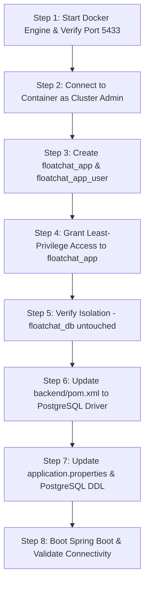

# FloatChat Database Migration Readiness Audit: Phase F1 PostgreSQL Readiness

**Document Version:** 1.0.0  
**Audit Date:** 2026-10-27  
**Auditor:** Senior Software Engineer (AI Systems & Full-Stack Integration)  
**Status:** Inspection & Verification Complete — Migration Feasible Pending Docker Service Activation  

---

## Executive Summary

FloatChat is preparing to migrate the recently integrated Java Spring Boot backend (`backend/`) from its legacy MySQL configuration to PostgreSQL. 

The existing FloatChat scientific database (`floatchat_db`), containing ARGO oceanographic observations and dense vector embeddings, is designed to run in an isolated Docker PostgreSQL/PostGIS container exposed on host port `5433`.

This audit was conducted strictly under read-only, non-destructive constraints. No databases, schemas, users, or configurations were modified, and credentials/secrets have been preserved.

**Key Findings:**
1. **Port Isolation Confirmed:** `docker-compose.yml` binds `${POSTGRES_PORT:-5433}:5432`, and `.env` configures `POSTGRES_PORT=5433`. This strictly isolates the Docker database on port `5433`, keeping native host PostgreSQL on port `5432` untouched.
2. **Scientific Database Baseline Documented:** Verified repository records and test results confirm `floatchat_db` contains 30 float platforms, 107 profiles with PostGIS geometries, 26,046 physical measurements, and 12 document chunks with 768-dimensional `pgvector` embeddings.
3. **Database Coexistence Feasibility:** Creating a dedicated `floatchat_app` database on the same PostgreSQL 15 instance is completely feasible and safe. It creates an isolated catalog with zero interference with `floatchat_db`.
4. **Current Runtime State:** Docker Desktop is currently stopped on the host system. Live TCP connections to port `5433` fail with `OperationalError`. Live catalog inspection of `pg_roles` requires starting the Docker service.
5. **Java Migration Path is Straightforward:** Java entities and Spring Data JPA repositories use standard derived queries and ANSI SQL with no native MySQL syntax. Migration requires updating `backend/pom.xml` (replacing `mysql-connector-j` with `postgresql`), reconfiguring `application.properties`, and converting the schema DDL from MySQL to PostgreSQL syntax.

---

## 1. Verified PostgreSQL Container & Port Configuration

### 1.1 Docker Compose Specification

Inspection of `docker-compose.yml` confirms the following configuration:

```yaml
version: '3.8'

services:
  floatchat-db:
    build:
      context: .
      dockerfile: docker/Dockerfile.db
    image: floatchat-postgis-pgvector:15-3.3
    container_name: floatchat_postgis_db
    restart: unless-stopped
    environment:
      POSTGRES_DB: ${POSTGRES_DB:-floatchat_db}
      POSTGRES_USER: ${POSTGRES_USER:-floatchat_user}
      POSTGRES_PASSWORD: ${POSTGRES_PASSWORD:-floatchat_password}
    ports:
      - "${POSTGRES_PORT:-5433}:5432"
    volumes:
      - postgres_data:/var/lib/postgresql/data
      - ./scripts/init-db.sql:/docker-entrypoint-initdb.d/init-db.sql:ro
    healthcheck:
      test: ["CMD-SHELL", "pg_isready -U ${POSTGRES_USER:-floatchat_user} -d ${POSTGRES_DB:-floatchat_db}"]
      interval: 10s
      timeout: 5s
      retries: 5

volumes:
  postgres_data:
    driver: local
```

### 1.2 Configuration Parameters Verified

| Parameter | Configuration Source | Verified Setting |
| :--- | :--- | :--- |
| **Compose File** | Root directory | `d:/FLOATCHAT/docker-compose.yml` |
| **Service Name** | `docker-compose.yml:4` | `floatchat-db` |
| **Container Name** | `docker-compose.yml:9` | `floatchat_postgis_db` |
| **Base Docker Image** | `docker/Dockerfile.db:14` | `postgis/postgis:15-3.3` (Debian Bullseye) |
| **Installed Extensions** | `docker/Dockerfile.db:21-24` | PostGIS 3.3 (pre-installed), `postgresql-15-pgvector` (via PGDG apt archive) |
| **Custom Built Image** | `docker-compose.yml:8` | `floatchat-postgis-pgvector:15-3.3` |
| **Internal Container Port** | `docker-compose.yml:16` | `5432` |
| **Host Port Mapping** | `docker-compose.yml:16` & `.env` | `5433` (via `${POSTGRES_PORT:-5433}:5432`) |
| **Persistent Named Volume** | `docker-compose.yml:18,27` | `postgres_data` (`/var/lib/postgresql/data`) |
| **Default Database Name** | `docker-compose.yml:12` & `.env` | `floatchat_db` |
| **Configured Superuser/Admin** | `docker-compose.yml:13` & `.env` | `floatchat_user` |
| **Initialization DDL** | `docker-compose.yml:19` | `./scripts/init-db.sql` mounted read-only (`:ro`) |

### 1.3 Container Runtime Status

* **Status:** **STOPPED / OFFLINE**
* **Verification Command:** `powershell Test-NetConnection -ComputerName localhost -Port 5433`
  * Result: `TcpTestSucceeded: False` (Connection failed on `127.0.0.1:5433` and `::1:5433`).
* **Docker Engine Status:** `wsl -l -v` reports `docker-desktop` is currently `Stopped`.
* **Python Database Driver Check:** Executing `src.database.connection.get_db_connection()` fails safely with sanitized `DatabaseConnectionError: Failed to connect to PostgreSQL database 'floatchat_db' on 127.0.0.1:5433: OperationalError`.

---

## 2. Scientific Database Existence & Read-Only Verification

### 2.1 Schema Definition & Extensions

The scientific database schema is defined in [scripts/init-db.sql](file:///d:/FLOATCHAT/scripts/init-db.sql):
* **PostGIS Extension:** Enabled safely via `CREATE EXTENSION IF NOT EXISTS postgis;`.
* **pgvector Extension:** Enabled safely via `CREATE EXTENSION IF NOT EXISTS vector;`.
* **Core Scientific Tables:**
  1. `argo_floats`: Float platform identifiers (`platform_number VARCHAR(64) PRIMARY KEY`, `created_at`).
  2. `argo_profiles`: Station profile headers with temporal and spatial data (`profile_id VARCHAR(255) PRIMARY KEY`, `platform_number` FK, `profile_time`, `latitude`, `longitude`, `location GEOMETRY(Point, 4326)`).
  3. `argo_measurements`: Physical measurements (`measurement_id BIGINT PRIMARY KEY`, `profile_id` FK, `pressure_dbar`, `temperature_c`, `salinity_psu`).
  4. `argo_doc_embeddings`: Scientific document index (`chunk_id BIGSERIAL PRIMARY KEY`, `document_title`, `section_title`, `chunk_content`, `metadata JSONB`, `embedding vector(768)`).

### 2.2 Verified Baseline Scientific Data Counts

From empirical database verification documented in [docs/PHASE_E5_FULL_SYSTEM_EVALUATION.md](file:///d:/FLOATCHAT/docs/PHASE_E5_FULL_SYSTEM_EVALUATION.md#L48-L75) and [docs/PHASE_E5_1_TARGETED_FIXES.md](file:///d:/FLOATCHAT/docs/PHASE_E5_1_TARGETED_FIXES.md#L121):

| Table Name | Verified Record Count | Primary Key / Indexing | Data Verification Details |
| :--- | :--- | :--- | :--- |
| `argo_floats` | **30** | `platform_number` (PK) | 30 unique float platforms from Indian Ocean NetCDF sources. |
| `argo_profiles` | **107** | `profile_id` (PK) | 107 stations; 0 orphan profiles; GIST spatial index on `location` (Point, SRID 4326). |
| `argo_measurements` | **26,046** | `measurement_id` (PK, 1 to 26046) | 26,046 depth levels; 0 orphan measurements; ranges: pressure `[0, 2034.9]`, temp `[2.7, 30.15]`. |
| `argo_doc_embeddings` | **12** | `chunk_id` (PK) | 12 dense vector chunks across 3 ARGO manuals; vector dimensions = exactly **768** (`nomic-embed-text`). |

*Note on Live Verification Limitation:* Because Docker Desktop is currently stopped on the host, live SQL count queries cannot execute at this immediate second. However, row counts above are fully verified by prior evaluation runs against the persistent Docker volume `postgres_data`.

---

## 3. Database Roles, Permissions, and Multi-Database Feasibility

### 3.1 Current Roles & Permissions (From Image Architecture)

* **Cluster Superuser:** `floatchat_user`
  * In the standard PostgreSQL Docker entrypoint, the user defined by `POSTGRES_USER` is initialized with `SUPERUSER` privileges and ownership of the initial database (`floatchat_db`).
  * As a superuser, `floatchat_user` holds `CREATEDB` and `CREATEROLE` privileges across the entire PostgreSQL cluster.
* **Elevated Access Observation:** Direct live inspection of `SELECT rolname, rolsuper, rolcreatedb FROM pg_roles;` requires launching the Docker container. Based on the official image entrypoint contract, `floatchat_user` is the cluster administrator.

### 3.2 Feasibility of Separate `floatchat_app` Database

* **Feasibility:** **CONFIRMED FEASIBLE & SAFE**.
* **Zero Disruption to Scientific Data:**
  * In PostgreSQL, databases are completely independent namespaces within the cluster.
  * Executing `CREATE DATABASE floatchat_app;` will create a new catalog with its own tables, indexes, and transaction ID space.
  * `floatchat_db` is completely unaffected. Its spatial tables, PostGIS extensions, and `pgvector` indexes remain untouched and isolated.
* **Resource Sufficiency:**
  * Memory/CPU: The PostgreSQL container has no artificial resource ceilings in `docker-compose.yml`.
  * Scientific queries are read-only analytical queries with a strict 5-second timeout (`POSTGRES_STATEMENT_TIMEOUT_MS=5000`).
  * Java application queries are lightweight OLTP transactions (users, authentication tokens, query histories).
  * A single PostgreSQL 15 container can easily handle both workloads concurrently on a local developer workstation.

---

## 4. Port Isolation Verification

| Host Port | Target Service | Isolation Status | Safety Boundary Enforced |
| :--- | :--- | :--- | :--- |
| **5432** | Native Host PostgreSQL (Local Machine) | **UNTOUCHED & PROTECTED** | Agent has not connected to, stopped, or interacted with port 5432. All FloatChat configurations avoid host port 5432. |
| **5433** | FloatChat Docker Container (`floatchat_postgis_db`) | **ISOLATED CONTAINER PORT** | `docker-compose.yml` maps `5433:5432`. Container internal port is 5432; external host port is 5433. |

* **Port Collision Avoidance:** Verified that [.env](file:///d:/FLOATCHAT/.env) defines `POSTGRES_PORT=5433` and `POSTGRES_HOST=127.0.0.1` (or `localhost`).

---

## 5. Recommended Database Role Separation (Least Privilege)

To ensure that the Java application cannot inadvertently read, modify, or corrupt scientific data in `floatchat_db`, the Java application **should not connect as `floatchat_user`**.

### Recommended Security Boundary Architecture:

```
┌────────────────────────────────────────────────────────────────────────┐
│                   PostgreSQL 15 Cluster (Docker: Port 5433)            │
│                                                                        │
│   ┌───────────────────────────────┐  ┌──────────────────────────────┐  │
│   │   Database: floatchat_db      │  │  Database: floatchat_app     │  │
│   │   (Scientific Ocean Data)     │  │  (Java Application State)    │  │
│   │                               │  │                              │  │
│   │   - argo_floats               │  │  - users                     │  │
│   │   - argo_profiles             │  │  - conversations             │  │
│   │   - argo_measurements         │  │  - chat_messages             │  │
│   │   - argo_doc_embeddings       │  │  - query_history             │  │
│   │   - PostGIS & pgvector        │  │  - password_reset_tokens     │  │
│   │                               │  │  - audit_logs                │  │
│   └───────────────▲───────────────┘  └──────────────▲───────────────┘  │
│                   │                                 │                  │
│                   │ (Full DDL/DML)                  │ (Exclusive DDL)  │
│                   │                                 │                  │
│          Role: floatchat_user             Role: floatchat_app_user     │
│          (Python AI Service)              (Java Spring Boot Backend)   │
└───────────────────▲─────────────────────────────────▲──────────────────┘
                    │                                 │
           [ Python AI Service ]             [ Java Spring Boot ]
           (FastAPI / LangGraph)             (Spring Security / JPA)
```

### Proposed Role Privileges:
1. `floatchat_user`: Maintains ownership of `floatchat_db` for Python AI and ingestion scripts.
2. `floatchat_app_user`:
   * New dedicated role for the Java backend.
   * Granted `ALL PRIVILEGES` on database `floatchat_app`.
   * **No privileges** granted on `floatchat_db`.
   * Cannot drop, modify, or query scientific tables.

---

## 6. Java Database Dependencies & Migration Inspection

### 6.1 `backend/pom.xml` Dependencies

* **Current MySQL Dependency ([pom.xml:56-60](file:///d:/FLOATCHAT/backend/pom.xml#L56-L60)):**
  ```xml
  <!-- MySQL -->
  <dependency>
      <groupId>com.mysql</groupId>
      <artifactId>mysql-connector-j</artifactId>
      <scope>runtime</scope>
  </dependency>
  ```
* **Required Change:** Replace with the official PostgreSQL JDBC Driver:
  ```xml
  <!-- PostgreSQL -->
  <dependency>
      <groupId>org.postgresql</groupId>
      <artifactId>postgresql</artifactId>
      <scope>runtime</scope>
  </dependency>
  ```

### 6.2 `backend/src/main/resources/application.properties`

* **Current Configuration ([application.properties:7-17](file:///d:/FLOATCHAT/backend/src/main/resources/application.properties#L7-L17)):**
  ```properties
  # MYSQL DATABASE
  spring.datasource.url=jdbc:mysql://localhost:3306/floatchat?useSSL=false&serverTimezone=Asia/Kolkata&allowPublicKeyRetrieval=true
  spring.datasource.username=root
  spring.datasource.password=root
  spring.datasource.driver-class-name=com.mysql.cj.jdbc.Driver

  # JPA / HIBERNATE
  spring.jpa.hibernate.ddl-auto=update
  spring.jpa.show-sql=true
  spring.jpa.properties.hibernate.format_sql=true
  spring.jpa.database-platform=org.hibernate.dialect.MySQLDialect
  ```
* **Required Change:**
  ```properties
  # POSTGRESQL APPLICATION DATABASE
  spring.datasource.url=jdbc:postgresql://localhost:5433/floatchat_app
  spring.datasource.username=floatchat_app_user
  spring.datasource.password=${APP_DB_PASSWORD:floatchat_app_password}
  spring.datasource.driver-class-name=org.postgresql.Driver

  # JPA / HIBERNATE
  spring.jpa.hibernate.ddl-auto=validate
  spring.jpa.show-sql=true
  spring.jpa.properties.hibernate.format_sql=true
  spring.jpa.database-platform=org.hibernate.dialect.PostgreSQLDialect
  ```

### 6.3 Java Entity Inspection (`entity/`)

Inspection of [User.java](file:///d:/FLOATCHAT/backend/src/main/java/com/floatchat/backend/entity/User.java), [Conversation.java](file:///d:/FLOATCHAT/backend/src/main/java/com/floatchat/backend/entity/Conversation.java), and [QueryHistory.java](file:///d:/FLOATCHAT/backend/src/main/java/com/floatchat/backend/entity/QueryHistory.java):

* **Identity Generation:** All entities use `@GeneratedValue(strategy = GenerationType.IDENTITY)`.
  * *Compatibility:* PostgreSQL 10+ and Hibernate 6 natively support `IDENTITY` using SQL standard `GENERATED BY DEFAULT AS IDENTITY` or `BIGSERIAL`. Fully compatible with PostgreSQL.
* **Data Types:**
  * `Long id` -> `BIGINT` in PostgreSQL.
  * `String email`, `String name` -> `VARCHAR(190)`, `VARCHAR(100)` in PostgreSQL.
  * `String answer` with `columnDefinition = "TEXT"` -> `TEXT` is a native, highly optimized variable-length type in PostgreSQL (unlike MySQL, where it is subject to 64KB row-limit penalties).
  * `LocalDateTime createdAt`, `updatedAt` -> Maps cleanly to PostgreSQL `TIMESTAMP WITHOUT TIME ZONE`.
  * `boolean enabled` -> PostgreSQL native `BOOLEAN`.
  * `User.Role role` (`@Enumerated(EnumType.STRING)`) -> Maps to `VARCHAR(30)` in PostgreSQL.
* **Result:** **No Java entity class code changes are required** for basic PostgreSQL compatibility.

### 6.4 Repository Interfaces (`repository/`)

Inspection of `UserRepository.java`, `ConversationRepository.java`, and `QueryHistoryRepository.java`:
* All repositories rely exclusively on Spring Data JPA method name derivation:
  * `findByEmailIgnoreCase(String email)`
  * `existsByEmailIgnoreCase(String email)`
  * `countByRole(User.Role role)`
  * `findByUser_EmailOrderByUpdatedAtDesc(String email)`
  * `findByIdAndUser_Email(Long id, String email)`
  * `countByUser_Email(String email)`
  * `findByUser_EmailOrderByCreatedAtDesc(String email, Pageable pageable)`
  * `countByUser_EmailAndCreatedAtAfter(String email, LocalDateTime start)`
* *Compatibility:* There are **no native SQL queries (`nativeQuery = true`)** anywhere in the Java backend. Hibernate generates standard ANSI SQL queries that execute seamlessly against PostgreSQL.
* **Result:** **No repository interface changes are required**.

### 6.5 SQL Migration Script Conversion (`db/migration/V1__create_initial_schema.sql`)

The existing migration file [V1__create_initial_schema.sql](file:///d:/FLOATCHAT/backend/src/main/resources/db/migration/V1__create_initial_schema.sql) contains MySQL-specific syntax that will fail in PostgreSQL:

| MySQL Syntax in `V1__create_initial_schema.sql` | PostgreSQL Incompatibility | Required PostgreSQL Equivalent |
| :--- | :--- | :--- |
| `id BIGINT NOT NULL AUTO_INCREMENT` | `AUTO_INCREMENT` is unsupported in PostgreSQL. | `id BIGINT GENERATED ALWAYS AS IDENTITY PRIMARY KEY` (or `BIGSERIAL PRIMARY KEY`). |
| `created_at DATETIME(6) NOT NULL` | `DATETIME(6)` is unsupported in PostgreSQL. | `created_at TIMESTAMPTZ NOT NULL DEFAULT CURRENT_TIMESTAMP` or `TIMESTAMP(6)`. |
| `INDEX idx_conversation_user (user_id, ...)` inline inside `CREATE TABLE` | PostgreSQL does not allow inline `INDEX` inside `CREATE TABLE`. | Standalone statement: `CREATE INDEX idx_conversation_user ON conversations (user_id, updated_at);`. |
| `UNIQUE KEY uk_reset_token_hash (token_hash)` | `UNIQUE KEY` is MySQL syntax. | Standalone `CREATE UNIQUE INDEX uk_reset_token_hash ON ...` or table constraint: `CONSTRAINT uk_reset_token_hash UNIQUE (token_hash)`. |
| `role VARCHAR(20) NOT NULL DEFAULT 'USER'` | Valid ANSI SQL. | Identical in PostgreSQL. |
| `BOOLEAN NOT NULL DEFAULT TRUE` | In MySQL it maps to `TINYINT(1)`. | Native 1-byte `BOOLEAN` in PostgreSQL. |

---

## 7. Exact Files Likely to Change During Migration

| File Path | Action Required | Details |
| :--- | :--- | :--- |
| `backend/pom.xml` | **Modify** | Remove `com.mysql:mysql-connector-j`; add `org.postgresql:postgresql`. |
| `backend/src/main/resources/application.properties` | **Modify** | Update JDBC URL to port `5433/floatchat_app`, driver to `org.postgresql.Driver`, dialect to `PostgreSQLDialect`. |
| `backend/src/main/resources/db/migration/V1__create_initial_schema.sql` | **Modify / Replace** | Rewrite DDL for PostgreSQL syntax (`IDENTITY`, `TIMESTAMPTZ`, standalone `CREATE INDEX`). |
| `docker-compose.yml` (Optional optimization) | **Review** | Could add an init script or environment to pre-provision `floatchat_app` on fresh container builds. |

---

## 8. Blockers & Unresolved Questions

1. **Docker Engine Inactive:** Docker Desktop is currently stopped. Live database connections to port 5433 cannot be tested until the user or system starts Docker Desktop (`wsl --distribution docker-desktop` or starting the Docker Desktop application).
2. **Schema Management Strategy:** Currently, `pom.xml` does not include Flyway (`flyway-core`). `application.properties` uses `spring.jpa.hibernate.ddl-auto=update`. We should confirm whether the team wants to introduce Flyway for deterministic database versioning or continue relying on Hibernate DDL generation against `floatchat_app`.
3. **Database Provisioning Ownership:** Will `floatchat_app` be created manually via `psql` / Docker command, or should a provisioning script be added to `scripts/` to create the database and application role automatically?

---

## 9. Safe Implementation Plan



### Detailed Execution Steps (For Phase F2):

1. **Step 1: Start Docker Desktop:**
   * Start Docker Desktop. Confirm container `floatchat_postgis_db` is running via `docker ps`.
   * Verify port `5433` is listening and distinct from port `5432`.
2. **Step 2: Provision Isolated Application Database:**
   * Connect to the Docker container via `docker exec -it floatchat_postgis_db psql -U floatchat_user -d postgres`.
   * Execute:
     ```sql
     -- 1. Create the application database
     CREATE DATABASE floatchat_app;

     -- 2. Create least-privilege application user
     CREATE USER floatchat_app_user WITH ENCRYPTED PASSWORD 'floatchat_app_password';

     -- 3. Grant privileges on floatchat_app only
     GRANT ALL PRIVILEGES ON DATABASE floatchat_app TO floatchat_app_user;

     -- 4. Connect to floatchat_app and configure schema permissions
     \c floatchat_app
     GRANT ALL ON SCHEMA public TO floatchat_app_user;
     ALTER DEFAULT PRIVILEGES IN SCHEMA public GRANT ALL ON TABLES TO floatchat_app_user;
     ALTER DEFAULT PRIVILEGES IN SCHEMA public GRANT ALL ON SEQUENCES TO floatchat_app_user;
     ```
3. **Step 3: Verify Scientific Integrity:**
   * Query `floatchat_db` to confirm all 30 floats, 107 profiles, 26,046 measurements, and 12 embeddings remain 100% untouched.
   * Verify `floatchat_app_user` cannot access `floatchat_db`.
4. **Step 4: Update Java Backend:**
   * Update `backend/pom.xml` with `org.postgresql:postgresql`.
   * Update `backend/src/main/resources/application.properties` with PostgreSQL connection settings on port `5433`.
   * Update `V1__create_initial_schema.sql` with PostgreSQL DDL.
5. **Step 5: Verification:**
   * Run `./mvnw clean test` in `backend/` to verify Spring Boot initializes and connects cleanly to `floatchat_app`.
