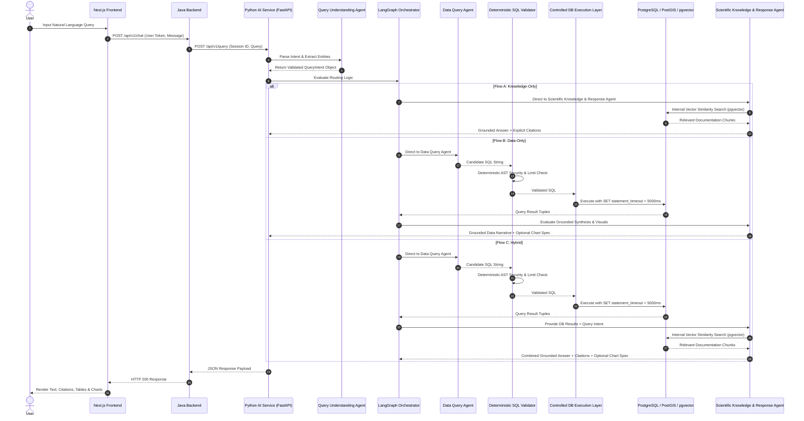

# FloatChat: System Architecture Specification

**Document Version:** 1.0.0  
**Phase:** Phase 0 (Architecture & Specification)  
**Status:** Approved Specification  

---

## 1. System Topology Overview

FloatChat is structured as a modular, service-oriented system designed to balance enterprise application concerns with advanced AI workflow orchestration.

```
+-----------------------------------------------------------------------------------+
|                               NEXT.JS FRONTEND                                    |
| - Interactive Chat UI & Markdown Renderer                                         |
| - Plotly / Recharts Visualization Canvas                                          |
| - Interactive Map Component (Leaflet / Mapbox)                                    |
+-----------------------------------------------------------------------------------+
                                          |
                                          v  (REST API / HTTPS)
+-----------------------------------------------------------------------------------+
|                     JAVA APPLICATION BACKEND (SPRING BOOT)                        |
| - User Authentication & Session Management                                        |
| - Chat History & Conversation Metadata Storage                                    |
| - API Gateway, Rate Limiting & Security Controls                                  |
+-----------------------------------------------------------------------------------+
                                          |
                                          v  (Internal REST API / HTTP)
+-----------------------------------------------------------------------------------+
|                        PYTHON AI SERVICE (FASTAPI)                                |
| - LangGraph Workflow Orchestration Engine (Supporting Component)                  |
| - LLM Provider Abstraction Layer (Ollama / Gemini)                                |
| - Exactly 3 Primary AI Agents:                                                    |
|     1. Query Understanding Agent                                                  |
|     2. Data Query Agent (Text-to-SQL)                                             |
|     3. Scientific Knowledge & Response Agent                                      |
| - Deterministic SQL Validator & Controlled DB Execution Layer                     |
+-----------------------------------------------------------------------------------+
                                          |
                                          v  (SQL Queries / Vector Search)
+-----------------------------------------------------------------------------------+
|                 UNIFIED DATABASE (POSTGRESQL + POSTGIS + PGVECTOR)                |
| - PostGIS: Spatial-temporal observation tables (floats, profiles, measurements)   |
| - pgvector: Vector embeddings index for scientific ARGO documentation             |
+-----------------------------------------------------------------------------------+
```

---

## 2. Component Responsibilities & Boundaries

### 2.1 Next.js Frontend
- **Role:** Web presentation layer.
- **Responsibilities:** Renders conversation history, markdown answers, scientific citations, execution step badges, dynamic chart graphics, and spatial profile locations on interactive maps.
- **Project Boundary:** Owned and implemented by another team member. Integrates with the system via standard REST API contracts.

### 2.2 Java Application Backend (Spring Boot)
- **Role:** Enterprise application gateway.
- **Responsibilities:** Manages user authentication (JWT), role-based access control, session persistence, conversation history storage, and API rate limiting.
- **Project Boundary:** Owned and implemented by another team member. Proxies user requests to the Python AI Service. Does **not** duplicate AI workflow or prompt logic.

### 2.3 Python AI Service (FastAPI)
- **Role:** AI workflow and orchestration engine.
- **Responsibilities:** Executes the stateful LangGraph workflow, coordinates the three primary AI agents, enforces LLM provider abstractions, executes the deterministic SQL validator, controls database execution with statement timeouts, and formats responses.
- **Project Boundary:** Core implementation responsibility of this project. Completely standalone and independently testable (Phases 1–10). Interacts directly with PostgreSQL/PostGIS.

### 2.4 Unified Database (PostgreSQL + PostGIS + pgvector)
- **Role:** Data and vector storage layer.
- **Responsibilities:** 
  - **PostGIS:** Serves as the **Numerical Source of Truth** for spatial-temporal ARGO profile measurements.
  - **pgvector:** Serves as the **Retrieval Infrastructure** for semantic similarity search over chunked ARGO documentation.

---

## 3. Data Flow Architecture

FloatChat processes three distinct types of user interactions through its LangGraph orchestrator coordinating exactly three primary AI agents:



---

## 4. Architectural Safeguards & Non-Overengineering Rules

1. **No Microservices Sprawl:** Single Python AI Service + Single Java Backend Service + Single Unified Database.
2. **No Message Queue Complexity:** Synchronous HTTP REST interaction between services; no Kafka or RabbitMQ required for core query workflows.
3. **No Unbounded Loops:** LangGraph state machine enforces direct acyclic workflows with a strict maximum of 1 SQL validation retry.
4. **Independent AI Development:** AI developers build and test Python FastAPI + LangGraph directly against PostgreSQL without needing the Java backend running during early development phases.
